# Flows prototype: pending decisions (5 Nov 2026)

A snapshot of the Flows decision inbox, open and parked cards only. The inbox is the live source: https://claude.ai/artifact/Hy7RgqyFfRF6tRgYgTw7ZQ

| Card | Question | Rec | Status |
| --- | --- | --- | --- |
| [add-picker](#add-picker) | Add menu colour, then a better picker | C1 | open |
| [branching](#branching) | Where simple branching lives | A | open |
| [card-status](#card-status) | Run-view card: how it shows its state | s4bar | open |
| [done-colour](#done-colour) | Colour for done: green or neutral | - | open |
| [entity-types](#entity-types) | Outputs of more than one entity type | switch-b | open |
| [hash-chrome](#hash-chrome) | The HASH sidebar around the editor | A | open |
| [history-links](#history-links) | How a 'Where runs failed' row links to its run | L2 | open |
| [history-stats](#history-stats) | Stats above the History chart | S4 | open |
| [history-table](#history-table) | History run table controls | P1 | open |
| [history-xaxis](#history-xaxis) | History chart axes (x and y) | Y2 | open |
| [icon-tile-colour](#icon-tile-colour) | Step icon tiles: kind tints or neutral? | A | open |
| [if-rename-description](#if-rename-description) | Renaming paths and editing a step's description | A | open |
| [output-used-in](#output-used-in) | Outputs: showing what uses each output | P1m | open |
| [outputs-container](#outputs-container) | Where a step's outputs open: inline, inline + expand, or modal | Inline | open |
| [outputs-viewer](#outputs-viewer) | Run outputs: click through to what a step produced | A | open |
| [run-log-minimal](#run-log-minimal) | Minimal run log | L1 | open |
| [run-outputs](#run-outputs) | Where a run's outputs show | A | open |
| [run-topbar](#run-topbar) | Run view top bar: same buttons, four layouts | 1 | open |
| [step-outputs](#step-outputs) | A step's outputs in a run | A | open |
| [switch-panel](#switch-panel) | Switch step panel (not built in the engine yet) | S1 | open |
| [trigger-fired](#trigger-fired) | The trigger that fired, in a run | 1 | open |
| [trigger-ghosts](#trigger-ghosts) | Ghost trigger nodes in the editor | 1 | open |
| [triggers-page](#triggers-page) | Flows › Triggers page | 3 | open |
| [triggers-scale](#triggers-scale) | Ghost trigger nodes at scale | 2 | open |
| [use-in-step](#use-in-step) | Outputs: how an output gets used in another step | U1 | open |
| [version-label-case](#version-label-case) | Version label: v6, V6 or Version 6 | lower | open |
| [node-glow](#node-glow) | Soft glow on run-view cards | bar | parked |
| [node-status](#node-status) | How a run-view card shows its status | 4 | parked |

## add-picker

**Add menu colour, then a better picker** (Editor · add a step)

Status: open

Question: 1) Which colour fix for the add menu? 2) Which picker take to develop next?

Recommendation: **C1**. C1: each group and its steps share one hue everywhere (canvas, Steps panel, menu). Picker: K1. Group → hue → steps: People → yellow → Ask a person · Messages → blue → Send email · Documents → orange → Fetch file · Entities → green → Find, Read, Create, Update entity · Flow control → purple → If, For each, Filter list (and the Other logic steps: Find in list, Order by, Take first, Aggregate). Steps in no group keep their kind tint (Start, AI, fetch). Tile s20, icon s100. Nothing changes the default until you pick.

### add-picker · C1 (recommended): Colour 1 · group and its steps in one hue

Each group row's icon takes its group's hue, and every step in that group uses exactly that hue: tinted tile (s20) with the icon at s100. People and Ask a person are both yellow, Flow control and If are both purple. The same tile colours show on the canvas and in the Steps panel. Menu sizes unchanged: 30 px tile, 8 px radius, 16 px icon. ?pickercolour=1.

Flags: `?pickercolour=1`

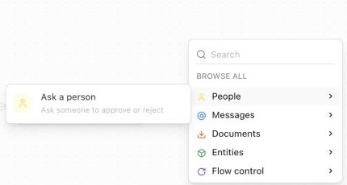

_C1 · People and Ask a person, both yellow_

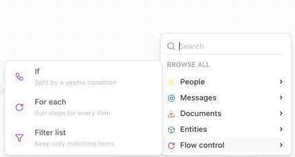

_C1 · Flow control and its steps, all purple_

### add-picker · C2: Colour 2 · C1 + small swatch on group rows

C1, plus a 6 px dot of the group's hue after each group name. The only option with any colour on group rows. ?pickercolour=2.

Flags: `?pickercolour=2`

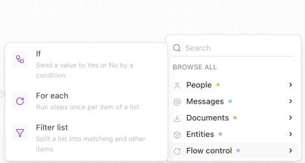

_C2 · Flow control, swatches on groups_

### add-picker · C3: Colour 3 · group hue on icon, grey tile

Grey tile, icon in the group hue. Group rows neutral. ?pickercolour=3.

Flags: `?pickercolour=3`

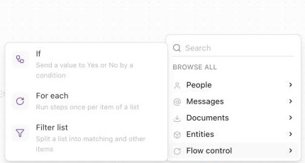

_C3 · Flow control_

### add-picker · K1: Picker K1 · search-first grouped list

Attio-style: search, Suggested, Recent, groups; line on hover. One component in canvas menu, Add tab, next-step. ?picker=1. Shown with C1: step tiles in the group hue, group headings neutral. Same component in the canvas menu, Add tab and next step.

Flags: `?picker=1`

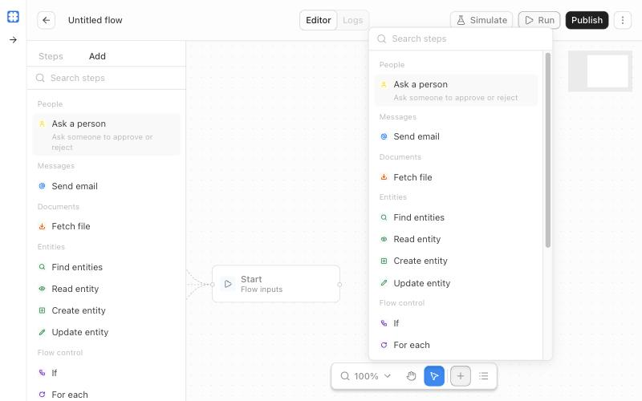

_K1 · canvas + Add tab, group hues_

### add-picker · K2: Picker K2 · two panes

Categories | steps. ?picker=2. Shown with C1: step tiles in the group hue, group headings neutral. Same component in the canvas menu, Add tab and next step.

Flags: `?picker=2`

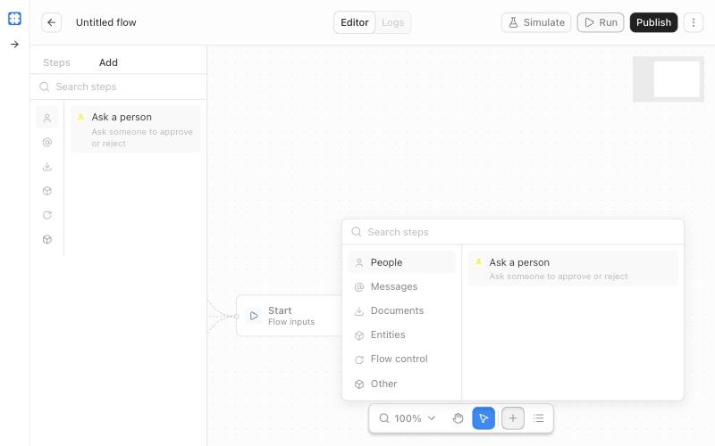

_K2 · canvas + Add tab, group hues_

### add-picker · K3: Picker K3 · command palette

Centred; search, suggestions by the previous step's output, recents. ?picker=3. Shown with C1: step tiles in the group hue, group headings neutral. Same component in the canvas menu, Add tab and next step.

Flags: `?picker=3`

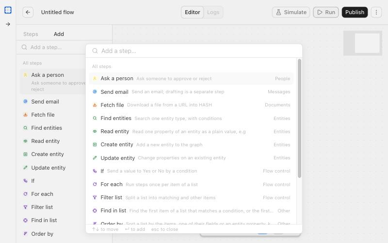

_K3 · canvas + Add tab, group hues_

### add-picker · K4: Picker K4 · right panel “Add a step”

Opens in the right panel with “After Find entities” context. ?picker=4. Shown with C1: step tiles in the group hue, group headings neutral. Same component in the canvas menu, Add tab and next step.

Flags: `?picker=4`

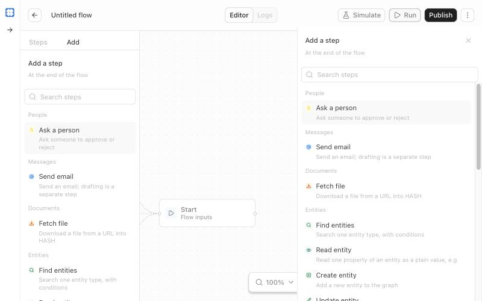

_K4 · canvas + Add tab, group hues_

## branching

**Where simple branching lives** (Branching)

Status: open

Question: Simple choice-based branching (Approved / Rejected, enum values) sits in the step panel. Under a Paths section, or under Outputs? Anything more complex becomes an If step either way. Dei weighs in at the 4 Nov sync (L116).

Recommendation: **A**. A, a Paths section. It keeps 'what comes out' and 'where it goes' separate.

### branching · A (recommended): 'Branch on' under Paths

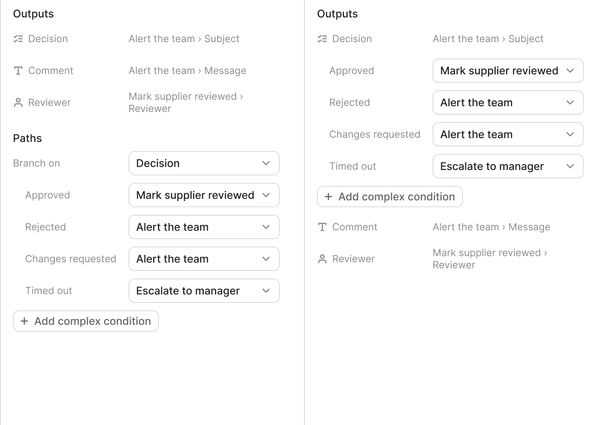

_A 1_

### branching · B: Under Outputs

_B 1_

## card-status

**Run-view card: how it shows its state** (Run view)

Status: open

Question: node-status and node-glow merged here, because both decide how a run-view card shows its state. Four contenders, each as the same 2× crop of the For each in Run 17 at 140 s with ?done=neutral (the darker done grey); a green comparison crop is below. Done colour (?done=green|neutral, its own card done-colour) and needs-review motion (?reviewmotion=off|once|loop, now tuned in the glow playground) apply to all four and are not contenders. Which contender?

Recommendation: **s4bar**. S4 + Bar, with needs-review motion once: the words name the cards that need you and the flat bar keeps item progress on every card, so it keeps S4's clarity in Alex's flat language without a red outline repeating the failed signal. Once, because motion means something is happening and needs review is a waiting state; one pulse catches the eye when it appears without many looping cards competing, and then the words and the run top bar's needs-review count carry it (Ciarán's "obvious queue elsewhere").

Moved to: [Card status playground](https://claude.ai/artifact/LyuSXpqZPP7c96hjfBK9cq)

### card-status · s4: S4 · words + red outline

node-status take 4: words above the cards that need you (Needs review, 1 failed), a faint red outline round a card with failures; only repeating steps keep the faint bar. · http://localhost:6011/flows/monthly-supplier-review/runs/16?nodestatus=4&done=neutral · Run 17: http://localhost:6011/flows/monthly-supplier-review/runs/17?at=140&pin&nodestatus=4&done=neutral · Repo: ops/projects/flows-editor/screenshots/app-1105/card-status/s4-*.png

Open: <http://localhost:6011/flows/monthly-supplier-review/runs/16?nodestatus=4&done=neutral> · <http://localhost:6011/flows/monthly-supplier-review/runs/17?at=140&pin&nodestatus=4&done=neutral>

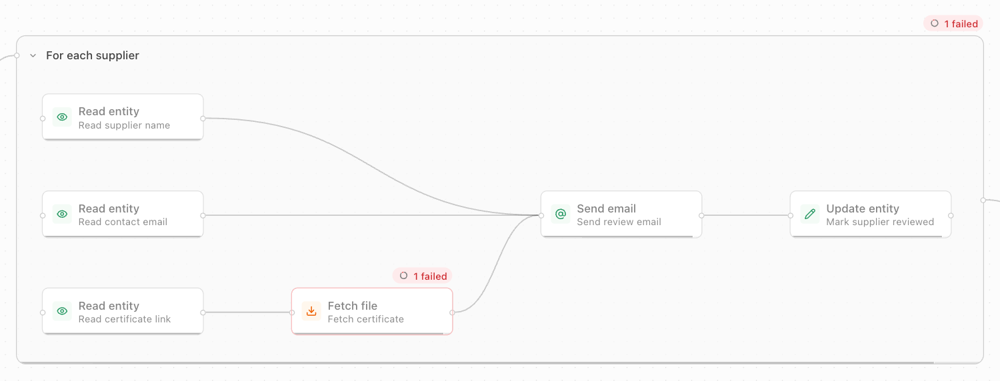

_Run 17 at 140 s · For each, 2× · ?done=neutral_

### card-status · bar: Bar · Alex's flat bar

No glow or shadow. The 2 px bar on every card; running sweeps and the spinner turns (motion is in the glow playground). · http://localhost:6011/flows/monthly-supplier-review/runs/16?nodeglow=bar&done=neutral · Run 17: http://localhost:6011/flows/monthly-supplier-review/runs/17?at=140&pin&nodeglow=bar&done=neutral · Repo: ops/projects/flows-editor/screenshots/app-1105/card-status/bar-*.png

Open: <http://localhost:6011/flows/monthly-supplier-review/runs/16?nodeglow=bar&done=neutral> · <http://localhost:6011/flows/monthly-supplier-review/runs/17?at=140&pin&nodeglow=bar&done=neutral>

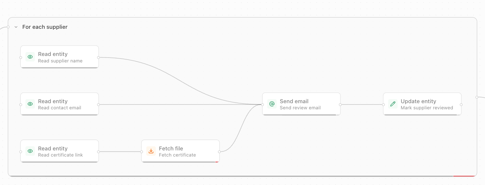

_Run 17 at 140 s · For each, 2× · ?done=neutral_

### card-status · mix: Mix · reflective bar (closest take)

No prototype take matches the playground's Positional preset (Take 3 refined: a glow rising from each bar segment in its own colour, crossfaded, done at 35%, breathing). The closest is ?nodeglow=3, the reflective bar: it is per segment, but done reflects at full weight, with no crossfade and no breathing. · http://localhost:6011/flows/monthly-supplier-review/runs/16?nodeglow=3&done=neutral · Run 17: http://localhost:6011/flows/monthly-supplier-review/runs/17?at=140&pin&nodeglow=3&done=neutral · Playground: https://claude.ai/artifact/LyuSXpqZPP7c96hjfBK9cq · Repo: ops/projects/flows-editor/screenshots/app-1105/card-status/mix-*.png

Flags: `?nodeglow=3`

Open: <http://localhost:6011/flows/monthly-supplier-review/runs/16?nodeglow=3&done=neutral> · <http://localhost:6011/flows/monthly-supplier-review/runs/17?at=140&pin&nodeglow=3&done=neutral> · <https://claude.ai/artifact/LyuSXpqZPP7c96hjfBK9cq>

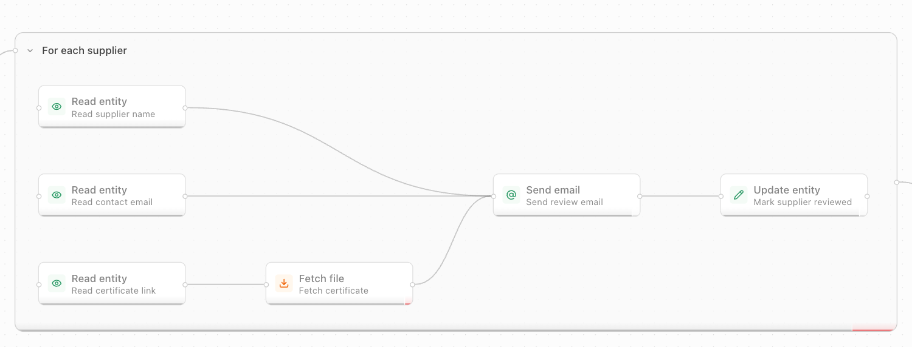

_Run 17 at 140 s · For each, 2× · ?done=neutral_

### card-status · s4bar (recommended): S4 + Bar · words over the flat bar

New take ?nodestatus=4bar: take 4's words, take 1's 2 px bar on every card with the flat-bar motion, no red outline. · http://localhost:6011/flows/monthly-supplier-review/runs/16?nodestatus=4bar&done=neutral · Run 17: http://localhost:6011/flows/monthly-supplier-review/runs/17?at=140&pin&nodestatus=4bar&done=neutral · Green: http://localhost:6011/flows/monthly-supplier-review/runs/17?at=140&pin&nodestatus=4bar&done=green · Repo: ops/projects/flows-editor/screenshots/app-1105/card-status/s4bar-*.png

Flags: `?nodestatus=4bar`

Open: <http://localhost:6011/flows/monthly-supplier-review/runs/16?nodestatus=4bar&done=neutral> · <http://localhost:6011/flows/monthly-supplier-review/runs/17?at=140&pin&nodestatus=4bar&done=neutral> · <http://localhost:6011/flows/monthly-supplier-review/runs/17?at=140&pin&nodestatus=4bar&done=green>

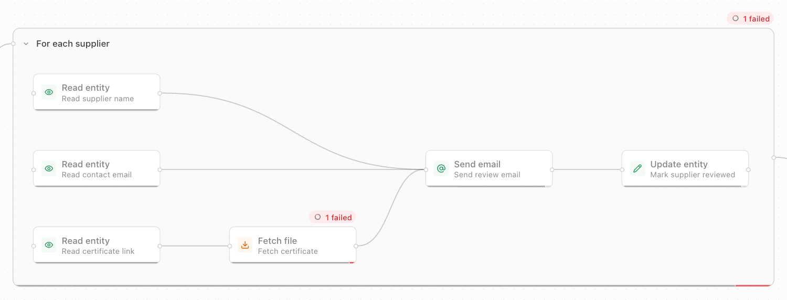

_Run 17 at 140 s · For each, 2× · ?done=neutral_

## done-colour

**Colour for done: green or neutral** (Run view)

Status: open

Question: Dei (Slack, 5 Nov): "we don't need to make a big song/dance/show 'green' for stuff completed… only show 'failed' and 'with warnings' nodes in red/yellow." One switch over every palette, ?done=green|neutral (URL only, default green). Neutral greys every done mark, bar and chart square and charts a run with warnings in amber; failed, running and needs review keep their colours. Which colour for done? Note: warnings amber and needs-review pale orange read close (picture below), so a purple needs review is offered as ?review=alt.

Recommendation: none given

### done-colour · green: Green

Today's done colours in each palette; a run with warnings charts as done. · http://localhost:6011/flows/monthly-supplier-review/runs/16?done=green · Run 17: http://localhost:6011/flows/monthly-supplier-review/runs/17?at=140&pin&done=green · History: http://localhost:6011/flows/monthly-supplier-review/history?at=140&pin&done=green · Repo: ops/projects/flows-editor/screenshots/app-1105/done-colour/green-*.png

Open: <http://localhost:6011/flows/monthly-supplier-review/runs/16?done=green> · <http://localhost:6011/flows/monthly-supplier-review/runs/17?at=140&pin&done=green> · <http://localhost:6011/flows/monthly-supplier-review/history?at=140&pin&done=green>

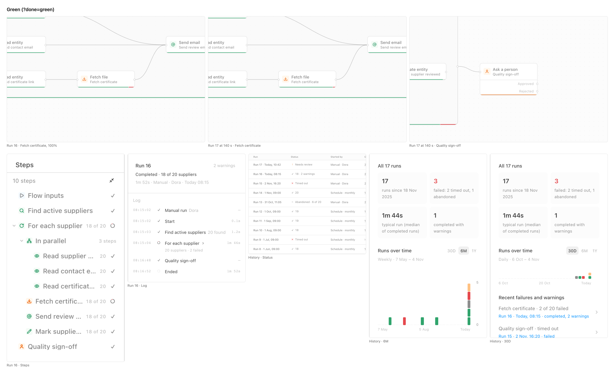

_Run 16 and Run 17 at 140 s at 100% · Steps · Log · History status, 6M and 30D_

### done-colour · neutral: Neutral

Done in grey that stays darker than skipped and not run: card bar neutral.s85, marks s100, chart s80. A run with warnings charts amber (yellow.s80). ?donegrey=faint shows the first, fainter take. · http://localhost:6011/flows/monthly-supplier-review/runs/16?done=neutral · Run 17: http://localhost:6011/flows/monthly-supplier-review/runs/17?at=140&pin&done=neutral · History: http://localhost:6011/flows/monthly-supplier-review/history?at=140&pin&done=neutral · Faint: http://localhost:6011/flows/monthly-supplier-review/runs/17?at=140&pin&done=neutral&donegrey=faint · Repo: ops/projects/flows-editor/screenshots/app-1105/done-colour/neutral-*.png

Flags: `?donegrey=faint`

Open: <http://localhost:6011/flows/monthly-supplier-review/runs/16?done=neutral> · <http://localhost:6011/flows/monthly-supplier-review/runs/17?at=140&pin&done=neutral> · <http://localhost:6011/flows/monthly-supplier-review/history?at=140&pin&done=neutral> · <http://localhost:6011/flows/monthly-supplier-review/runs/17?at=140&pin&done=neutral&donegrey=faint>

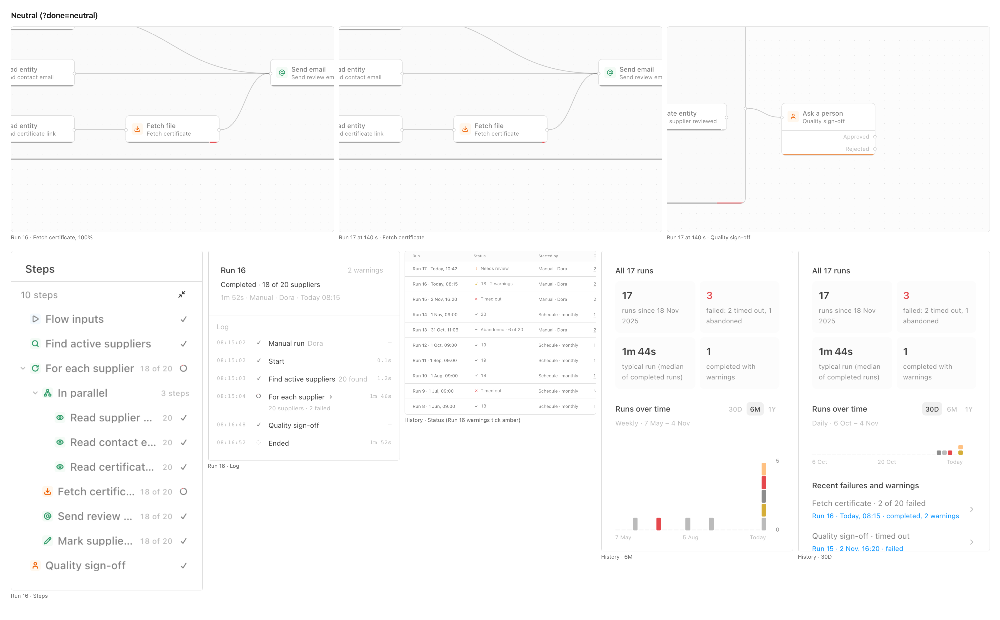

_Same frames, ?done=neutral · Run 16's warnings tick now amber in History_

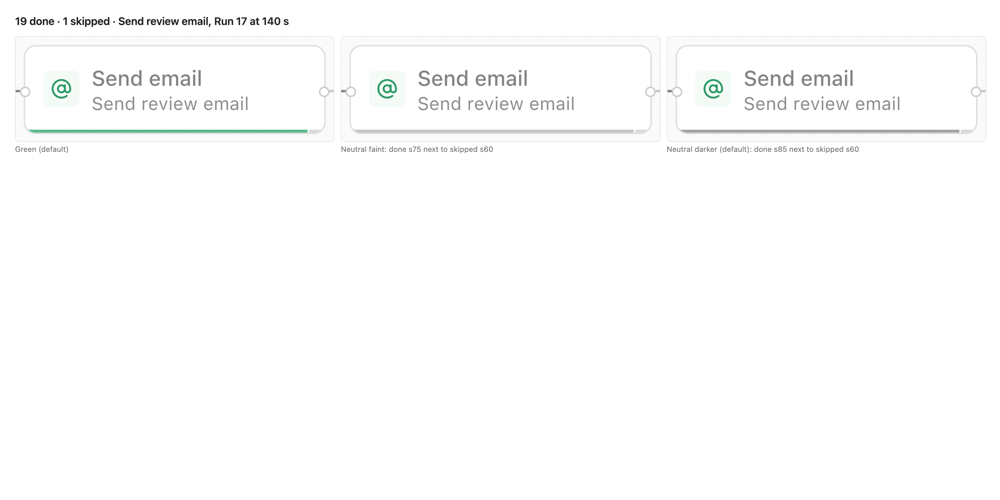

_19 done · 1 skipped: green, faint grey (s75) and the darker grey (s85, default) next to skipped s60_

### done-colour · neutral-review-alt: Neutral, needs review purple

Neutral, with needs review in Figma DS purple (chart s70, mark s85, card bar s75) so it never reads as the warnings amber. No other state is purple. · http://localhost:6011/flows/monthly-supplier-review/runs/17?at=140&pin&done=neutral&review=alt · History: http://localhost:6011/flows/monthly-supplier-review/history?at=140&pin&done=neutral&review=alt · Repo: ops/projects/flows-editor/screenshots/app-1105/done-colour/neutral-review-alt-*.png

Open: <http://localhost:6011/flows/monthly-supplier-review/runs/17?at=140&pin&done=neutral&review=alt> · <http://localhost:6011/flows/monthly-supplier-review/history?at=140&pin&done=neutral&review=alt>

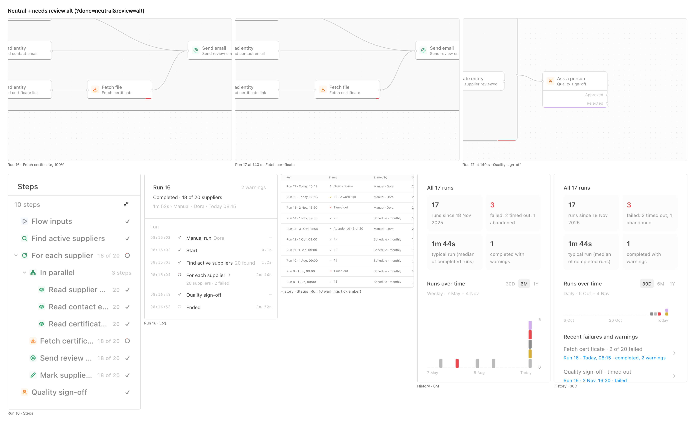

_Same frames, ?done=neutral&review=alt · Run 16's warnings tick amber in History_

## entity-types

**Outputs of more than one entity type** (Run view)

Status: open

Question: Ciarán (4 Nov): outputs can be entities of any type, so we need a type column or grouping by type. Run 14's Find active suppliers now returns 14 Suppliers and 6 Distributors (a Distributor has a Region). Which way in the viewer and the History Outputs column? ?entitytypes=a|b; no param is A.

Recommendation: **switch-b**. Switch · type tabs (with A's grouping inside each tab): both types and their counts show before you scroll, and switching takes one click, while stacked sections push Distributors below the fold and the filter hides the other types behind a menu. Past three or four types the tabs won't fit 383 px, and that is where the filter takes over. Earlier pick for the table: A, group by type.

### entity-types · A: Group by type

One table per type, each with only its own columns (Region shows for Distributors only). History counts each type: "14 suppliers · 6 distributors", each opening its own rows. · http://localhost:6011/flows/monthly-supplier-review/runs/14?step=findSuppliers&entitytypes=a · History: http://localhost:6011/flows/monthly-supplier-review/history?entitytypes=a · Repo: ops/projects/flows-editor/screenshots/app-1105/slack-followups/t2-a-*.png

Open: <http://localhost:6011/flows/monthly-supplier-review/runs/14?step=findSuppliers&entitytypes=a> · <http://localhost:6011/flows/monthly-supplier-review/history?entitytypes=a>

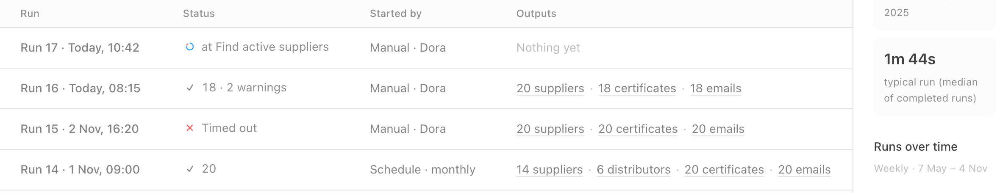

_A · History, Run 14_

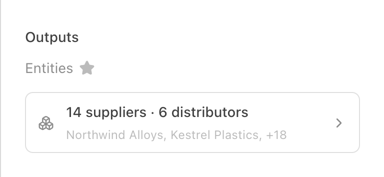

_A · Find active suppliers outputs_

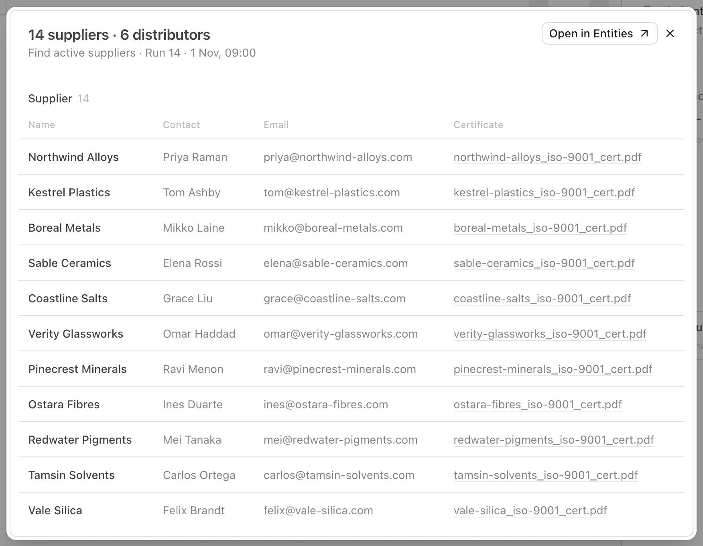

_A · the viewer, grouped_

### entity-types · B: Type column

One table, a Type column after Name; a column only some types have (Region) is blank for the rest. History says "20 entities". · http://localhost:6011/flows/monthly-supplier-review/runs/14?step=findSuppliers&entitytypes=b · History: http://localhost:6011/flows/monthly-supplier-review/history?entitytypes=b · Repo: ops/projects/flows-editor/screenshots/app-1105/slack-followups/t2-b-*.png

Open: <http://localhost:6011/flows/monthly-supplier-review/runs/14?step=findSuppliers&entitytypes=b> · <http://localhost:6011/flows/monthly-supplier-review/history?entitytypes=b>

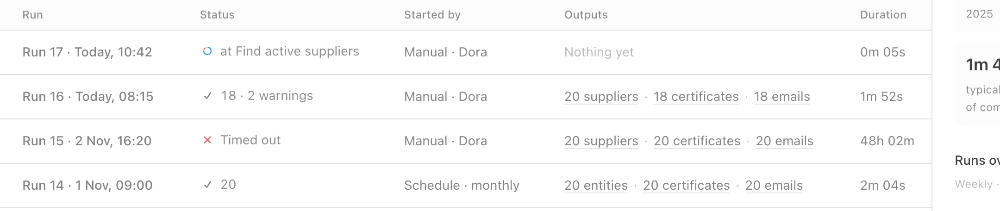

_B · History, Run 14_

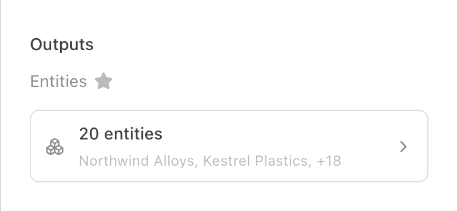

_B · Find active suppliers outputs_

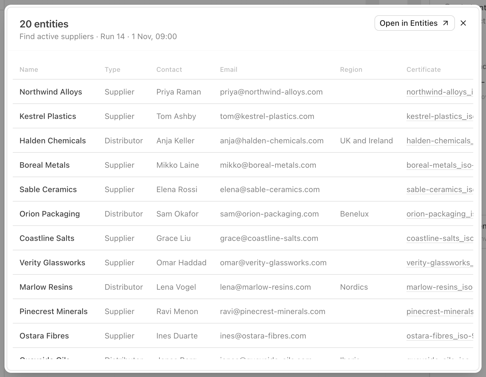

_B · the viewer, Type column_

### entity-types · switch-a: Switch · stacked sections

Today's column: a heading and count per type; scroll moves between them, 5 rows each with "+ N more". Distributors start below the fold. · http://localhost:6011/flows/monthly-supplier-review/runs/14?step=findSuppliers&outputs=inline&entityswitch=a · Repo: ops/projects/flows-editor/screenshots/app-1105/entity-switch/switch-a-*

Open: <http://localhost:6011/flows/monthly-supplier-review/runs/14?step=findSuppliers&outputs=inline&entityswitch=a>

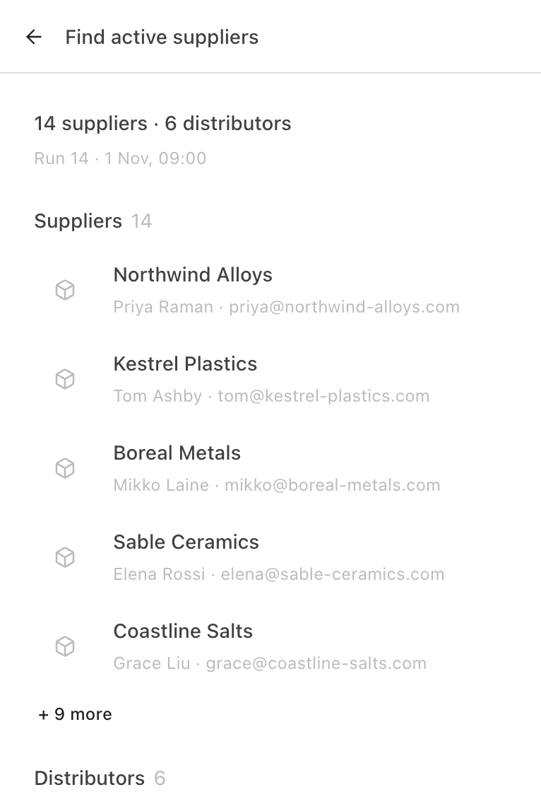

_Switch a · rest_

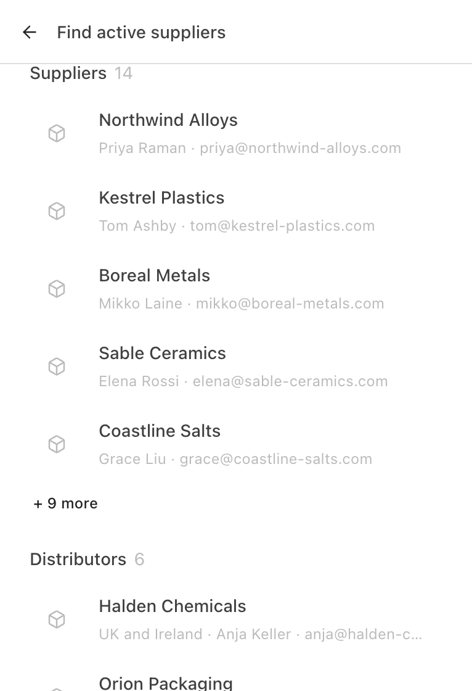

_Switch a · scrolled to Distributors_

### entity-types · switch-b (recommended): Switch · type tabs

"Suppliers 14 · Distributors 6" as quiet tabs above the list (regular weight, faint fill when on); each tab shows its own list with "+ N more". · http://localhost:6011/flows/monthly-supplier-review/runs/14?step=findSuppliers&outputs=inline&entityswitch=b · Repo: ops/projects/flows-editor/screenshots/app-1105/entity-switch/switch-b-*

Open: <http://localhost:6011/flows/monthly-supplier-review/runs/14?step=findSuppliers&outputs=inline&entityswitch=b>

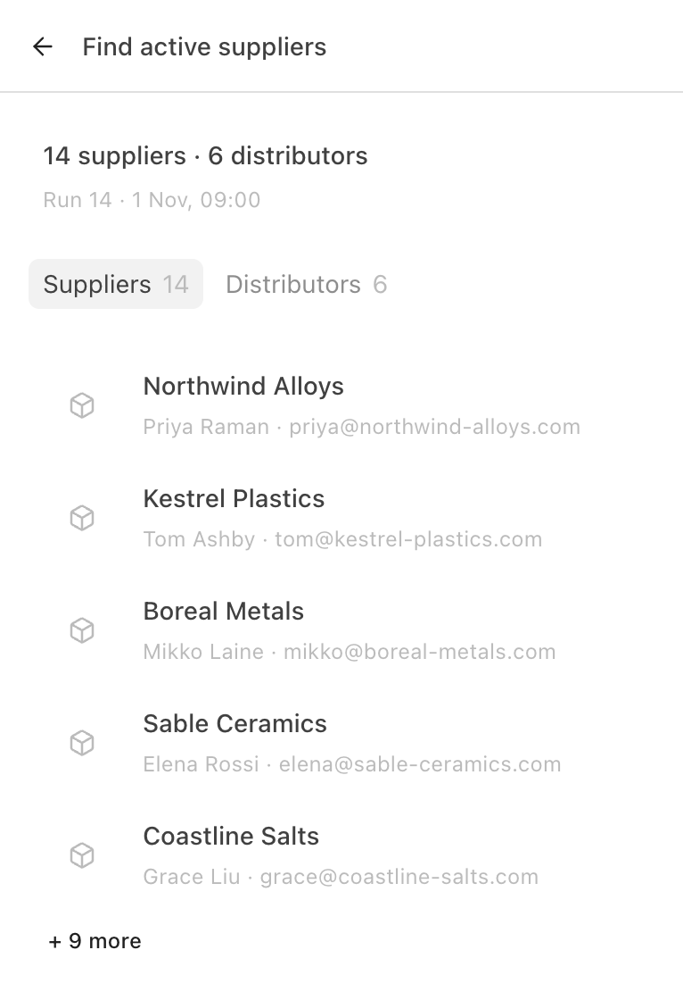

_Switch b · rest, Suppliers_

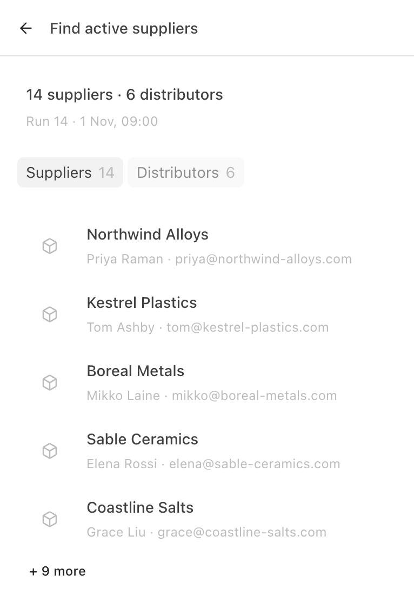

_Switch b · hover Distributors_

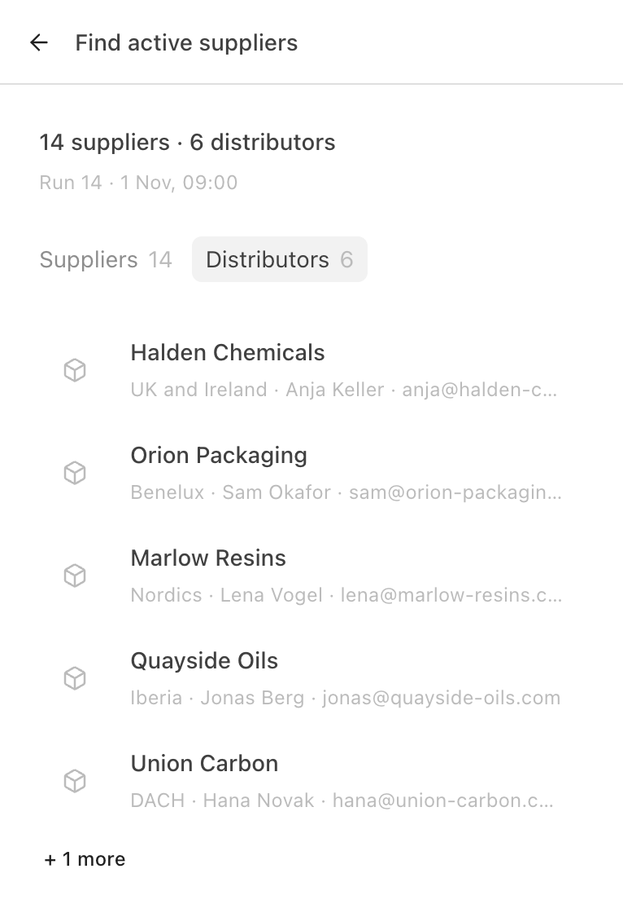

_Switch b · Distributors tab_

### entity-types · switch-c: Switch · type filter

"All types 20 ▾" heads the list (DS Menu with counts); All shows the stacked sections, picking a type shows only its rows. · http://localhost:6011/flows/monthly-supplier-review/runs/14?step=findSuppliers&outputs=inline&entityswitch=c · Repo: ops/projects/flows-editor/screenshots/app-1105/entity-switch/switch-c-*

Open: <http://localhost:6011/flows/monthly-supplier-review/runs/14?step=findSuppliers&outputs=inline&entityswitch=c>

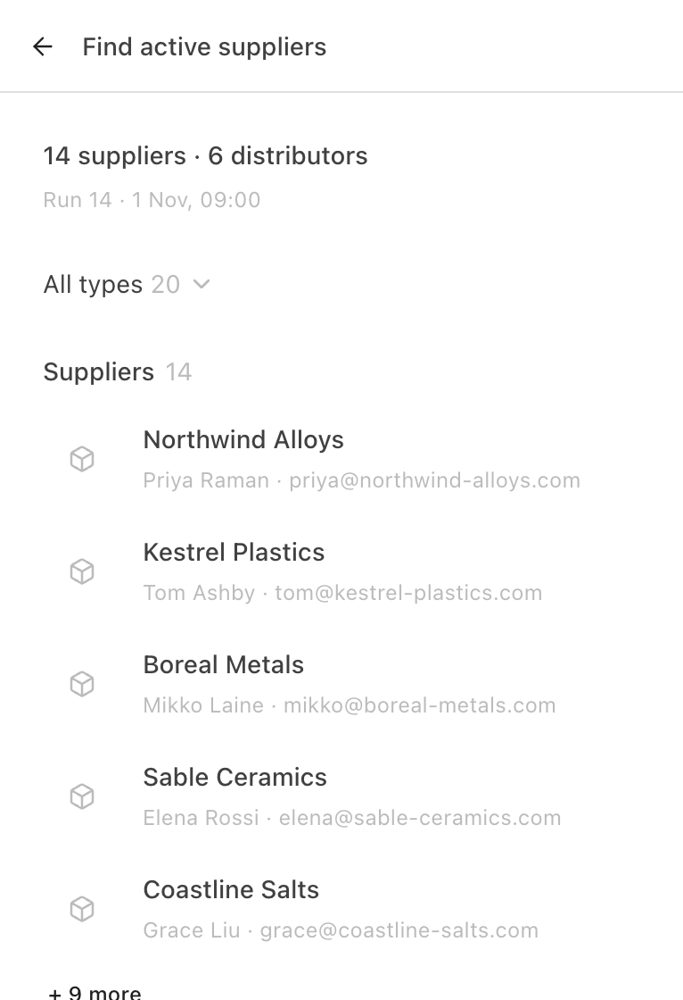

_Switch c · rest, All types_

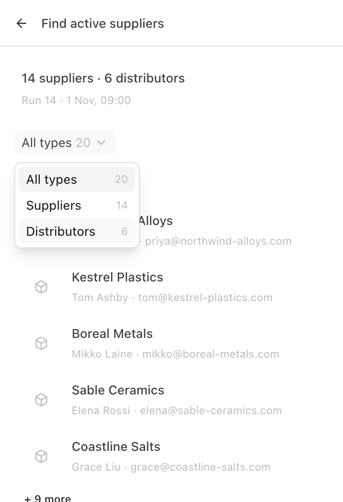

_Switch c · filter open_

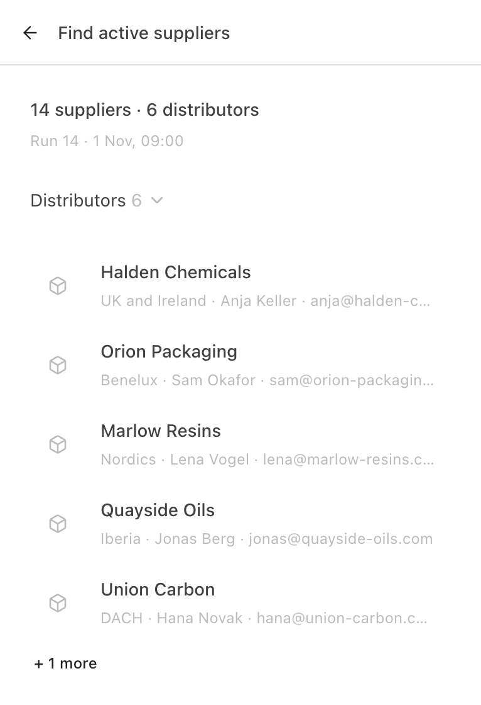

_Switch c · Distributors picked_

## hash-chrome

**The HASH sidebar around the editor** (HASH chrome)

Status: open

Question: No Figma file has a newer app shell. Keep prod's 60 px header and collapse the sidebar to its 42 px strip in the editor. Which item is highlighted? (Ciarán should confirm the route.)

Recommendation: **A**. A, Processes. The PRD and Dei's Models › Processes proposal both put flow editing there.

### hash-chrome · A (recommended): Processes

Breadcrumb 'Processes › flow name', as in H-6720.

### hash-chrome · B: Agents › Flows

What prod code highlights for /flows today, behind the workers flag.

## history-links

**How a 'Where runs failed' row links to its run** (Run history)

Status: open

Question: The bright blue link felt disturbing. How should a failure row show that it opens the run?

Recommendation: **L2**. L2. The whole row is the link, with a grey hover and a chevron like the HASH sidebar. The run number is darker and medium weight so you can scan for it. No blue.

### history-links · L1: Neutral row, grey hover

Grey text and a chevron; the whole row opens the run. The first row is shown hovered.

Figma: <https://www.figma.com/design/69r6JuKZ2kAr61h7Ci40kh/Flows?node-id=1139-594>

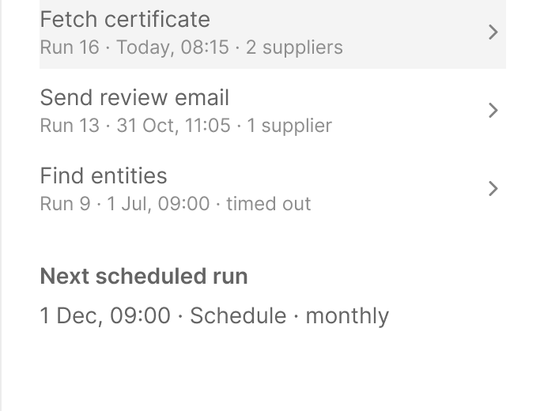

_L1 (2×)_

### history-links · L2 (recommended): Run number in darker text

Same as L1, but 'Run 16' is dark and medium weight so you can scan for it.

Figma: <https://www.figma.com/design/69r6JuKZ2kAr61h7Ci40kh/Flows?node-id=1139-648>

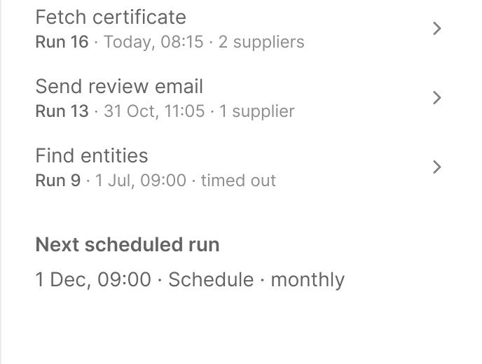

_L2 (2×)_

### history-links · L3: DS Link button

The DS link component is the same bright blue, at 14 px. It's consistent with the DS but the loudest thing in the panel.

Figma: <https://www.figma.com/design/69r6JuKZ2kAr61h7Ci40kh/Flows?node-id=1139-701>

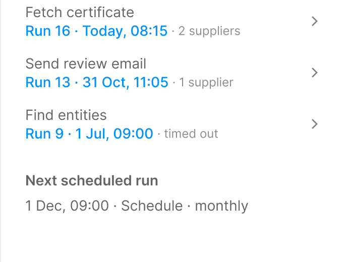

_L3 (2×)_

## history-stats

**Stats above the History chart** (Run history)

Status: open

Question: Which stats go above the chart, and how should they be written?

Recommendation: **S4**. S4: you picked it on 4 Nov because it shows what you act on (the last failure, the next run), and the counts already live in the chart. Its rows also fit the run values at this width, which the 2×2 tiles do not. Average run time: mean (what "average" usually means), or keep the median?

### history-stats · S4 (recommended): S4 rows (current)

Label–value rows: Last failure, With warnings (only when a run has them), Next run, Average run time. The counts stay in the chart. · http://localhost:6011/flows/monthly-supplier-review/logs?at=140&pin · Repo: ops/projects/flows-editor/screenshots/app-1105/logs-stats-s4/stats-rows-2x.png

Open: <http://localhost:6011/flows/monthly-supplier-review/logs?at=140&pin>

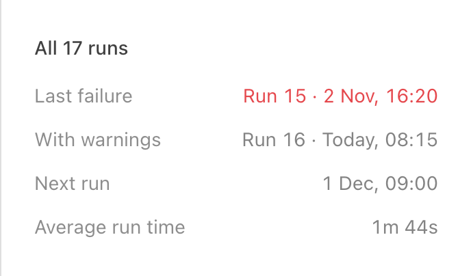

_Logs right panel, 2× · Run 15 · 2 Nov, 16:20 fits (143 px in a 295 px row)_

### history-stats · T1: T1 · 2×2 tiles

The same four facts as M2-sized tiles (12 px padding, lg radius, 84 px min height, lg value over an xs label, faint neutral border) in a 2×2 grid. "Run 15 · 2 Nov, 16:20" needs 173 px and gets 118 px (144 px tile), so it ends in an ellipsis. · http://localhost:6011/flows/monthly-supplier-review/logs?at=140&pin&stats=tiles1 · Repo: ops/projects/flows-editor/screenshots/app-1105/logs-stats-s4/stats-tiles1-2x.png

Open: <http://localhost:6011/flows/monthly-supplier-review/logs?at=140&pin&stats=tiles1>

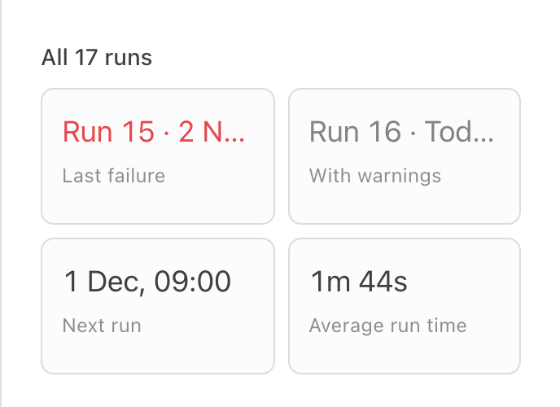

_Same panel width · the run values truncate: 173 px of text in a 118 px tile_

### history-stats · T2: T2 · stacked tiles

The same tiles, stacked. Everything fits (269 px of room for 173 px of text) but the block is about twice as tall, which pushes the chart down. · http://localhost:6011/flows/monthly-supplier-review/logs?at=140&pin&stats=tiles2 · Repo: ops/projects/flows-editor/screenshots/app-1105/logs-stats-s4/stats-tiles2-2x.png

Open: <http://localhost:6011/flows/monthly-supplier-review/logs?at=140&pin&stats=tiles2>

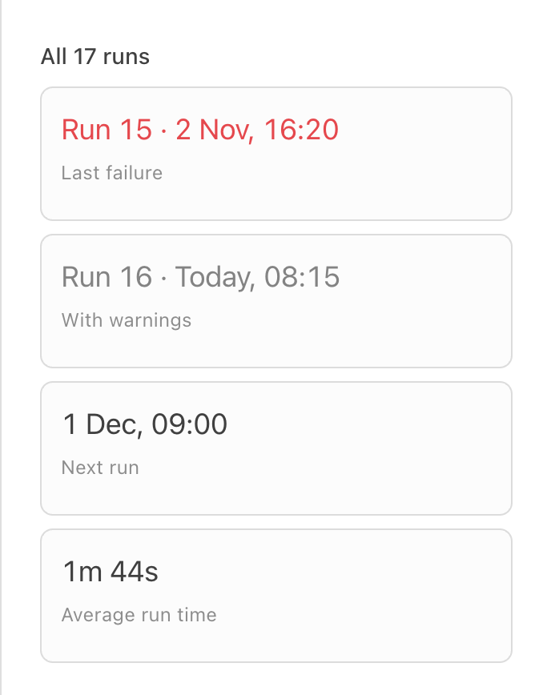

_Same panel width · fits (269 px in a 295 px tile), about twice the height of S4_

## history-table

**History run table controls** (Run history)

Status: open

Question: 5 Nov, Aakarsh: the runs table's left edge sat in from the title, and "Show more" showed with empty space below. Every option aligns the table with "Runs" and the first chip (first-column text 114 → 66 px, title 66 px). How should the table page once runs pass the height? (?runs=140 seeds 140 runs; to be settled with the team.)

Recommendation: **P1**. P1: the list fills the space it has, so nothing hides behind a button while room is left, and one "Show all" row is the least to build and the least to click. Paging (P3) or loading on scroll (P4) can come later if runs grow past a few hundred.

### history-table · P1 (recommended): Align + P1 (rec)

Rows fill the height the page has (up to 25); a quiet "Show all N runs" row loads the rest in place; the header sticks. Cheapest to build: one measured row count and one boolean. · http://localhost:6011/flows/monthly-supplier-review/logs?runs=140&runspage=p1 · 17 runs: http://localhost:6011/flows/monthly-supplier-review/logs?runspage=p1 · Repo: ops/projects/flows-editor/screenshots/app-1105/runs-table/p1-*.png

Open: <http://localhost:6011/flows/monthly-supplier-review/logs?runs=140&runspage=p1> · <http://localhost:6011/flows/monthly-supplier-review/logs?runspage=p1>

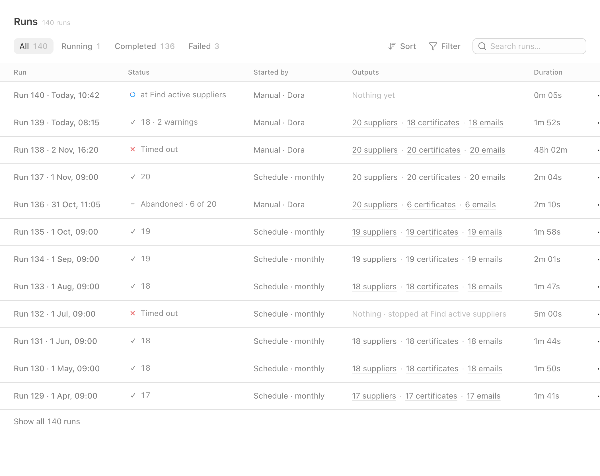

_140 runs: 12 rows fill the page, then "Show all 140 runs"_

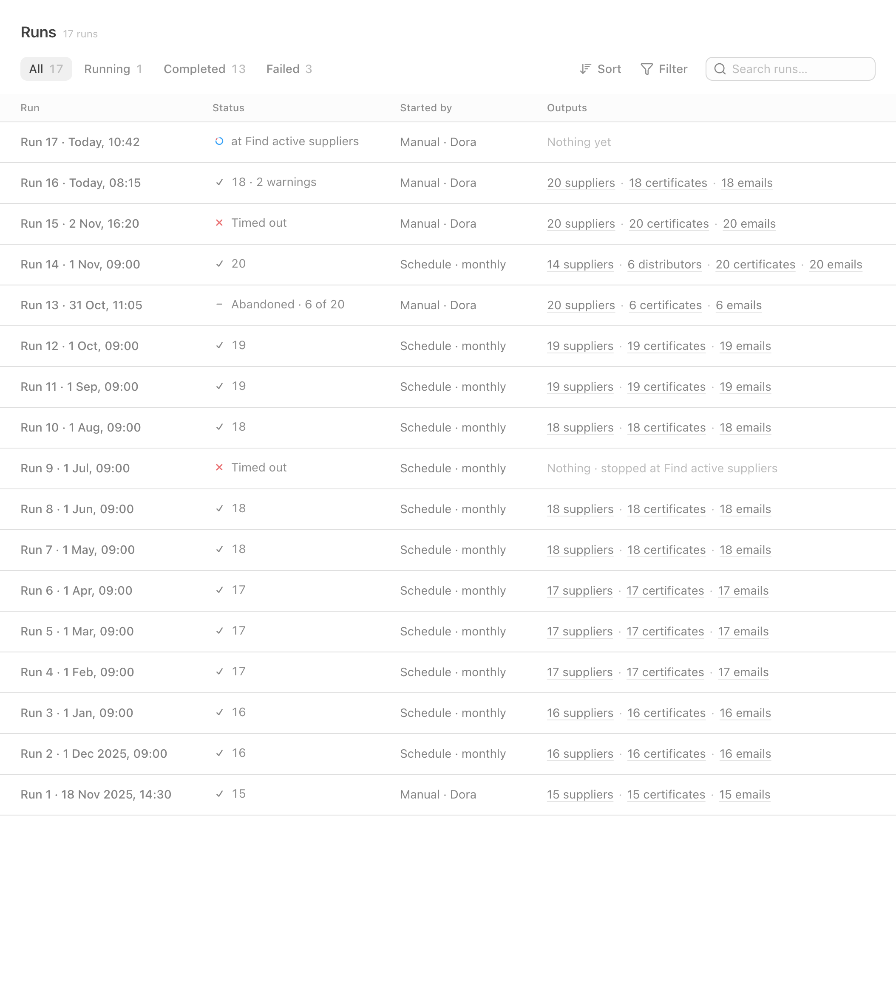

_17 runs in a taller window (1240 px): all fit, no button_

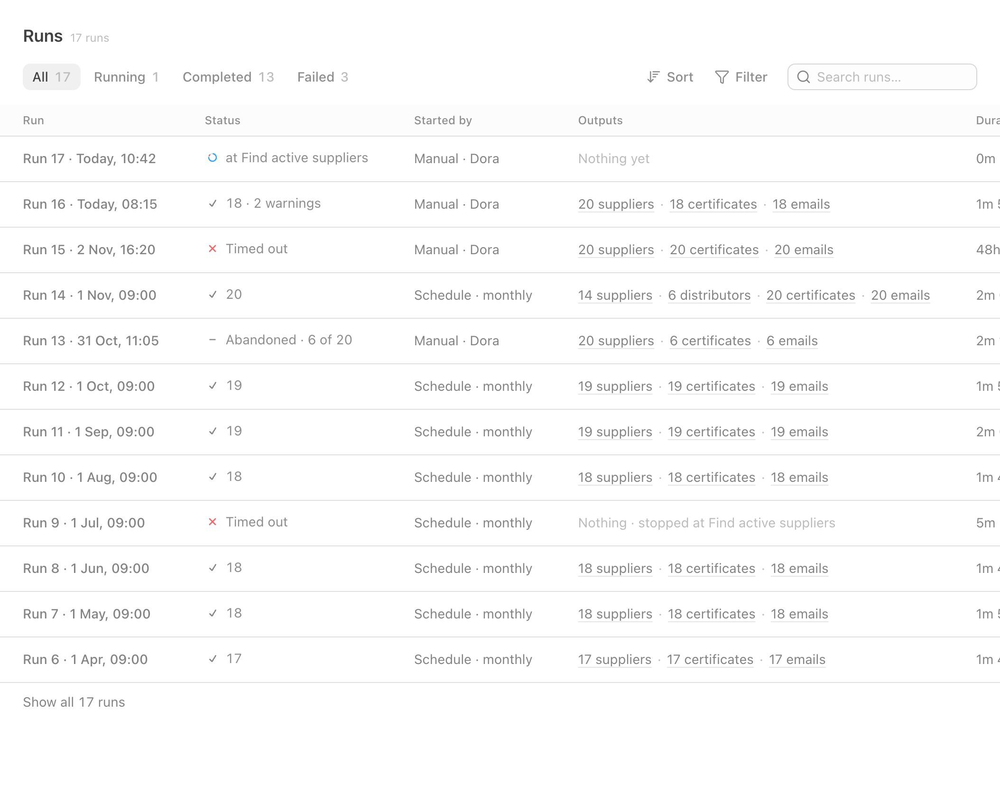

_17 runs at 900 px: 12 fit, so the row reads "Show all 17 runs"_

### history-table · P2: Align + P2

The same fill, then "Show 25 more" with "12 of 140", repeating. A little more state (a loaded count); many clicks to reach old runs. · http://localhost:6011/flows/monthly-supplier-review/logs?runs=140&runspage=p2 · Repo: ops/projects/flows-editor/screenshots/app-1105/runs-table/p2-140.png

Open: <http://localhost:6011/flows/monthly-supplier-review/logs?runs=140&runspage=p2>

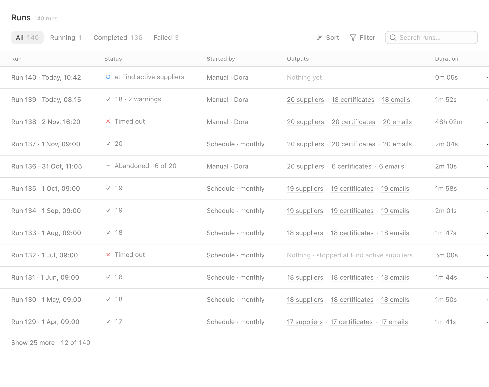

_140 runs: fill, then "Show 25 more · 12 of 140"_

### history-table · P3: Align + P3

Classic pager, 25 a page, "1–25 of 140 ‹ ›" at the bottom right. Needs server paging and page state in the URL to be shareable; 25 rows overflow the height, so the pager sits below the fold. · http://localhost:6011/flows/monthly-supplier-review/logs?runs=140&runspage=p3 · Repo: ops/projects/flows-editor/screenshots/app-1105/runs-table/p3-140-bottom.png

Open: <http://localhost:6011/flows/monthly-supplier-review/logs?runs=140&runspage=p3>

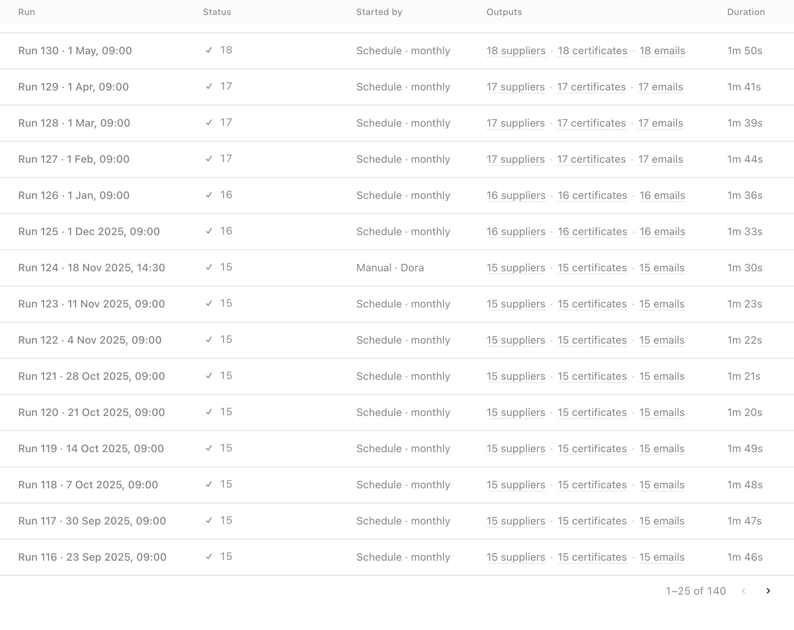

_140 runs, scrolled to the pager: "1–25 of 140 ‹ ›"_

### history-table · P4: Align + P4

Starts at 25 rows and loads 25 more as you near the end; no button. Most to build (scroll tracking, a loading state, cursor paging) and hard to reach the footer or see the total. · http://localhost:6011/flows/monthly-supplier-review/logs?runs=140&runspage=p4 · Repo: ops/projects/flows-editor/screenshots/app-1105/runs-table/p4-140*.png

Open: <http://localhost:6011/flows/monthly-supplier-review/logs?runs=140&runspage=p4>

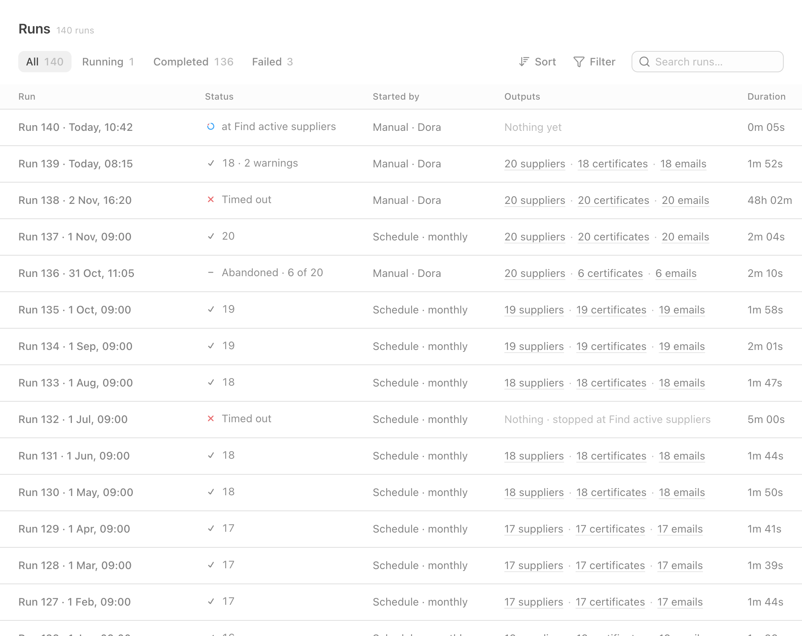

_140 runs: starts at 25 rows_

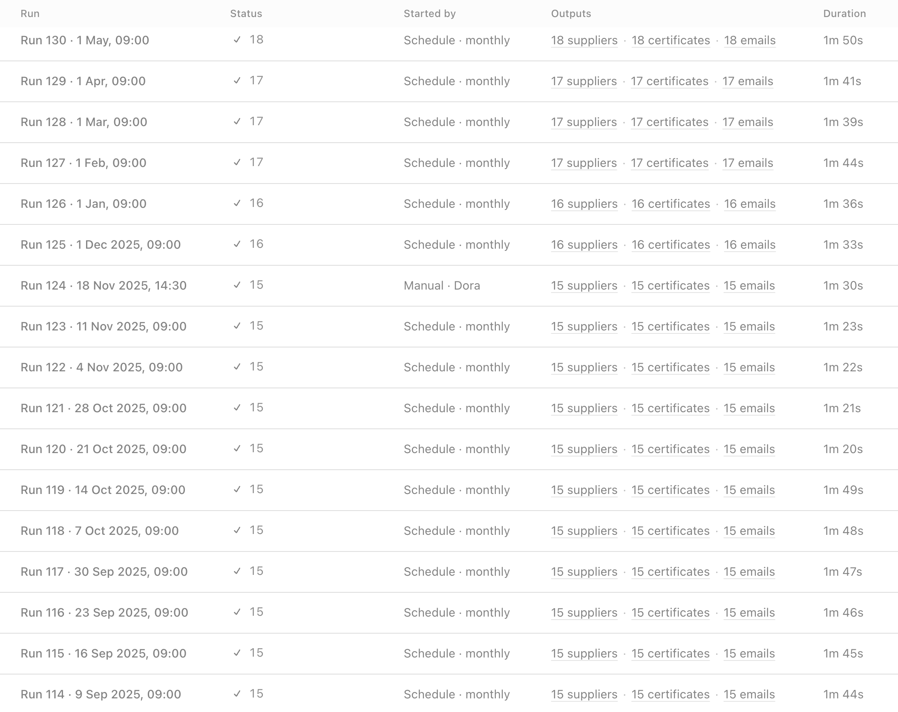

_Scrolled: 25 more loaded (50), header stuck at the top_

## history-xaxis

**History chart axes (x and y)** (Run history)

Status: open

Question: Which y-axis, paired with X1 dates?

Recommendation: **Y2**. Y2. Labels sit in their own left gutter, and the two faint lines give scale without crowding the bars. Y4 if you want it quieter still.

### history-xaxis · Y1: Y1 · 0 / 100 / 200, right gutter

A fixed 28 px gutter on the right; lines at 0, 100 and 200.

Figma: <https://www.figma.com/design/69r6JuKZ2kAr61h7Ci40kh/?node-id=1290-2312>

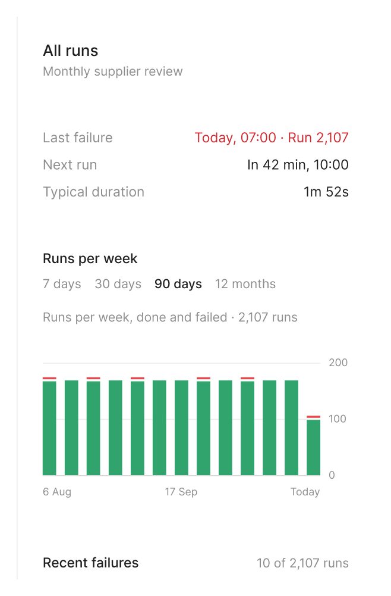

_Y1 + X1, under the S4 stats_

### history-xaxis · Y2 (recommended): Y2 · left labels, mid and max lines

Labels in a left gutter; faint lines at 100 and 200 only.

Figma: <https://www.figma.com/design/69r6JuKZ2kAr61h7Ci40kh/?node-id=1290-2413>

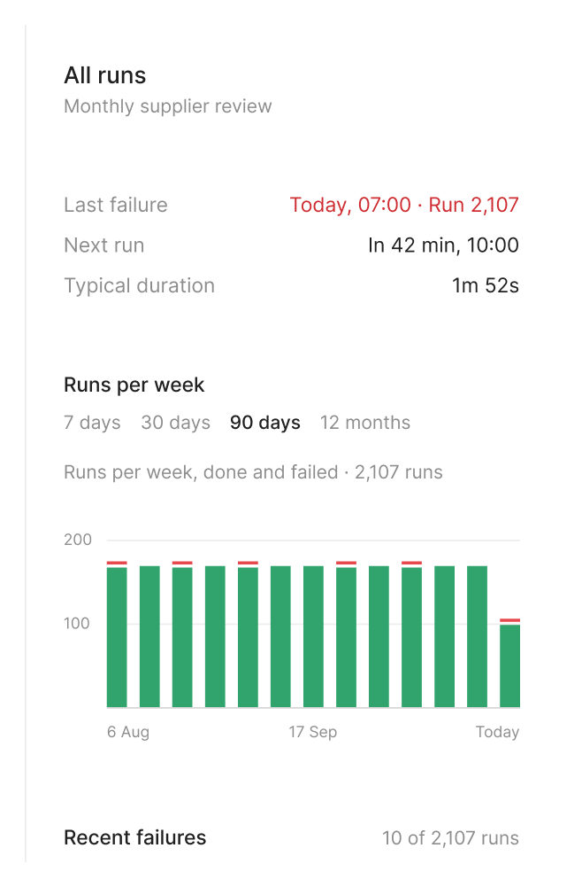

_Y2 + X1, under the S4 stats_

### history-xaxis · Y3: Y3 · max only (GitHub)

One faint line at the max, "168 max" top right.

Figma: <https://www.figma.com/design/69r6JuKZ2kAr61h7Ci40kh/?node-id=1290-2513>

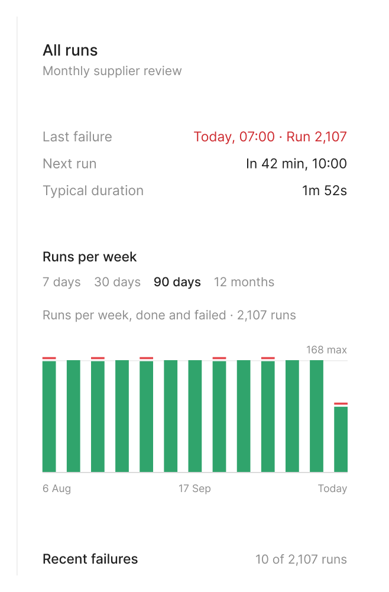

_Y3 + X1, under the S4 stats_

### history-xaxis · Y4: Y4 · no labels, value on hover

Just the baseline; the count shows next to the cursor.

Figma: <https://www.figma.com/design/69r6JuKZ2kAr61h7Ci40kh/?node-id=1290-2611>

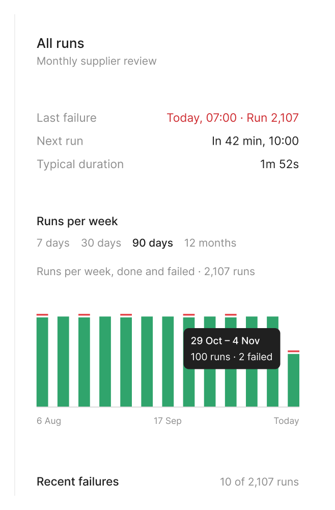

_Y4 + X1, hovering the current week_

### history-xaxis · X1: X1 · start, middle, today (paired with every Y)

Kept from round 1.

Figma: <https://www.figma.com/design/69r6JuKZ2kAr61h7Ci40kh/?node-id=1222-120857>

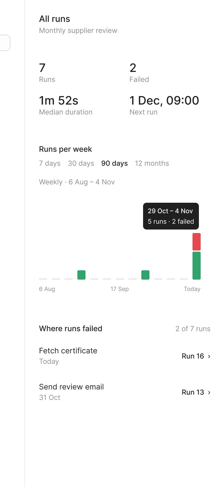

_X1 1_

## icon-tile-colour

**Step icon tiles: kind tints or neutral?** (Colour)

Status: open

Question: Which tile and icon treatment?

Recommendation: **A**. A with T1 tiles: tinted tile and tinted icon (heading step), one hue per heading, in the editor and the add menu. Runs stay quiet: done is a grey tick, and only failed and needs review are coloured. T3 is the fallback if tiles feel heavy.

### icon-tile-colour · A (recommended): Tinted in the editor, neutral in runs

Kind colour while building and status colour while running, so the two never share a row.

Figma: <https://www.figma.com/design/69r6JuKZ2kAr61h7Ci40kh/Flows?node-id=1266-151930>

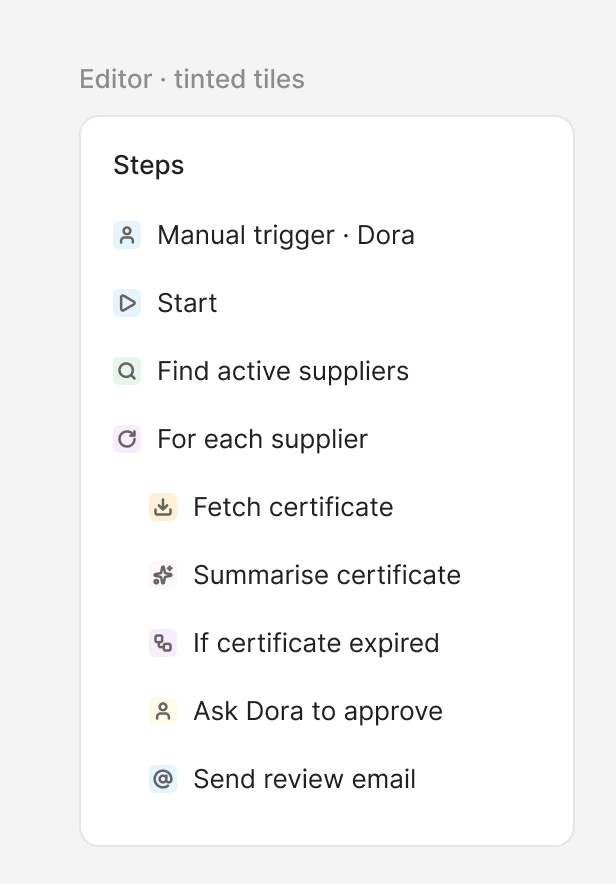

_Editor · tinted_

_Run · neutral_

_Add menu: tinted by kind (the menu is in the editor, so A and B look the same here); left of three_

### icon-tile-colour · B: Tinted everywhere (Attio)

Every step keeps its kind tint in runs: green entity tiles beside green ticks, and blue tiles beside the blue running ring.

Figma: <https://www.figma.com/design/69r6JuKZ2kAr61h7Ci40kh/Flows?node-id=1266-152041>

_Editor · tinted_

_Run · tinted_

_Add menu: tinted by kind, same as A, since the menu is in the editor; left of three_

### icon-tile-colour · C: Neutral everywhere (Linear, Stripe, prototype O2)

The calmest, but kinds read only from their icon shape while building.

Figma: <https://www.figma.com/design/69r6JuKZ2kAr61h7Ci40kh/Flows?node-id=1266-151987>

_Editor · neutral_

_Run · neutral_

_Add menu: neutral; middle of three_

### icon-tile-colour · D: Tint AI only

Every tile neutral except AI (Pink s30). The section headings do the grouping, as in the prototype Add tab.

Figma: <https://www.figma.com/design/69r6JuKZ2kAr61h7Ci40kh/Flows?node-id=1302-3102>

_Add menu: AI tiles tinted, everything else neutral; right of three_

### icon-tile-colour · T1: T1 · tinted tile, icon tinted to match

Tile at s30 with the icon at the same hue's heading step, as Attio does. Runs: done is a grey tick; only failed and needs review have colour.

Figma: <https://www.figma.com/design/69r6JuKZ2kAr61h7Ci40kh/Flows?node-id=1307-2738>

_T1 · tinted tile, icon tinted to match: editor (top) and run (bottom), left column_

_Add menu, one hue per heading, left of three_

### icon-tile-colour · T2: T2 · neutral tile, bolder coloured icon

Grey tile, icon in the kind colour (fg/icon/heading). Runs: done is a grey tick, and only failed (red/fg/icon/heading) and needs review (orange/fg/icon/heading) have colour.

Figma: <https://www.figma.com/design/69r6JuKZ2kAr61h7Ci40kh/Flows?node-id=1307-2888>

_T2 · neutral tile, bolder coloured icon: editor (top) and run (bottom), middle column_

_Add menu, one hue per heading, middle of three_

### icon-tile-colour · T3: T3 · no tile, coloured icon only

Icon alone at 14 px in the kind colour (fg/icon/heading). Runs: done is a grey tick, and only failed (red/fg/icon/heading) and needs review (orange/fg/icon/heading) have colour.

Figma: <https://www.figma.com/design/69r6JuKZ2kAr61h7Ci40kh/Flows?node-id=1307-3038>

_T3 · no tile, coloured icon only: editor (top) and run (bottom), right column_

_Add menu, one hue per heading, right of three_

## if-rename-description

**Renaming paths and editing a step's description** (Branching)

Status: open

Question: Is this how a step's description and its path names should be edited? Each If path is named after its condition until renamed (L104, L126), the name shows on the canvas port, and Otherwise stays fixed text. Every step's description uses the same pen-next-to-the-text control as the flow name.

Recommendation: **A**. A. Otherwise is the catch-all for anything no path matches, so its name should always mean the same thing on every If step. The other paths are named after their condition by default ('Decision is Approved'), so they make sense before anyone renames them.

### if-rename-description · A (recommended): As drawn: names default from the condition, Otherwise fixed

Figma: <['https://www.figma.com/design/69r6JuKZ2kAr61h7Ci40kh/Flows?node-id=1103-21', 'https://www.figma.com/design/69r6JuKZ2kAr61h7Ci40kh/Flows?node-id=1103-423', 'https://www.figma.com/design/69r6JuKZ2kAr61h7Ci40kh/Flows?node-id=1103-761', 'https://www.figma.com/design/69r6JuKZ2kAr61h7Ci40kh/Flows?node-id=1103-1096', 'https://www.figma.com/design/69r6JuKZ2kAr61h7Ci40kh/Flows?node-id=1103-1646', 'https://www.figma.com/design/69r6JuKZ2kAr61h7Ci40kh/Flows?node-id=1103-2175']>

_A 1_

_A 2_

_A 3_

_A 4_

### if-rename-description · B: Same, but Otherwise can be renamed too

Figma: <['https://www.figma.com/design/69r6JuKZ2kAr61h7Ci40kh/Flows?node-id=1103-1096']>

_B 1_

## output-used-in

**Outputs: showing what uses each output** (Step panel)

Status: open

Question: How should an output show the steps that use it? 2 Nov rule: type icon always, dependents named, node pills on hover only.

Recommendation: **P1m**. P1 with its ⋮ menu: plain names by default, with field and display set per step.

Moved to: [Outputs playground](https://claude.ai/artifact/XFRTb5DcNJJfBiuTKgAAKq)

### output-used-in · P1m (recommended): P1 + menu · hover ×, + Use in a step

Plain-text tree, as decided. Hovering a step shows the field it fills ("fills Reason" = the Reason input on Escalate to manager), a ⋮ and a ×. The × replaces "Stop using here", like Attio's Next step rows. The ⋮ menu keeps Fills field (Reason ✓ / Note / Subject) and Show as (Plain text ✓ / Pill / Count only). Every output ends with a faint "+ Use in a step" row in the empty slot, like Attio's "+ Select next block". There are no bordered cards; spacing is 40/36/24. Try it live: https://claude.ai/artifact/XFRTb5DcNJJfBiuTKgAAKq

Open: <https://claude.ai/artifact/XFRTb5DcNJJfBiuTKgAAKq>

Figma: <['https://www.figma.com/design/69r6JuKZ2kAr61h7Ci40kh/Flows?node-id=1302-4434']>

_Closed (hover): fills Reason_

_Open: Fills field_

_Attio table: record ref = icon + name, no chip · one-to-one steal_

_Attio record page: relationships as icon + underlined name · one-to-one steal_

_Attio workflow variable tokens · adapted_

_Attio column header menu: no display switch · adapted_

### output-used-in · P1: P1 · Plain-text tree

Muted step icon and name hang off a thin L-elbow, like Linear sub-issues. Hovering a step gives it a faint tint and full-strength text (Escalate to manager shown). There is no box at rest. Unused outputs show nothing; hovering one shows "+ Use in a step".

Figma: <['https://www.figma.com/design/69r6JuKZ2kAr61h7Ci40kh/Flows?node-id=1295-2393']>

_P1 1_

_Linear sub-issues · one-to-one steal_

_Notion backlinks · adapted_

### output-used-in · P2: P2 · Arrow line

One muted line under the output: "→ Alert the team, Escalate to manager, Ask a person". Each name is clickable and underlines on hover. Long lists wrap under the first name. Unused outputs show nothing; hovering one shows "+ Use in a step".

Figma: <['https://www.figma.com/design/69r6JuKZ2kAr61h7Ci40kh/Flows?node-id=1295-2498']>

_P2 1_

_Figma Navigate to · adapted_

_Retool Depends on · adapted_

### output-used-in · P3: P3 · Icon stack + count

At rest, a small stack of step icons plus a count sits on the right of the row. Opening it shows a plain-text list of the steps (Supplier name is shown open). It is the most compact take. Unused outputs show nothing; hovering one shows "+ Use in a step".

Figma: <['https://www.figma.com/design/69r6JuKZ2kAr61h7Ci40kh/Flows?node-id=1295-2578']>

_P3 1_

_Attio avatar stack · adapted_

_GitHub Used by · one-to-one steal_

### output-used-in · P4: P4 · Right-side wire

A hairline leaves the output and fans into a quiet column of muted step names on the right, like n8n wires. It reads as data flowing out. Unused outputs show nothing; hovering one shows "+ Use in a step".

Figma: <['https://www.figma.com/design/69r6JuKZ2kAr61h7Ci40kh/Flows?node-id=1295-2679']>

_P4 1_

_n8n wires · one-to-one steal_

_Make connectors · adapted_

### output-used-in · A: A · L-tree with pills (to compare)

Each consuming step hangs off a thin elbow under the output, like a file tree. Quiet with one child, grows cleanly with three. Reads at a glance without hovering. Unused outputs show nothing; hover shows + Use in a step (Certificate link).

Figma: <['https://www.figma.com/design/69r6JuKZ2kAr61h7Ci40kh/Flows?node-id=1293-2320']>

_A 1_

### output-used-in · A1: A1 · Attio 1:1, for fields that reference an item directly

1:1 copy of Attio. No used-in on the source; full path in a tooltip.

Figma: <['https://www.figma.com/design/69r6JuKZ2kAr61h7Ci40kh/Flows?node-id=1275-138521']>

_A1 1_

## outputs-container

**Where a step's outputs open: inline, inline + expand, or modal** (Run view)

Status: open

Question: Where a step's output opens, in the run view and History. This settles outputs-viewer and entity-types together. Built in the prototype behind ?outputs=inline|expand|modal (URL only; no param is today's modal). Every picture is Run 16: For each supplier's outputs (18 suppliers · 18 certificates · 18 emails, so the type grouping shows inside the container), the first certificate opened from that list, and History's "18 certificates" clicked.

Recommendation: **Inline**. Inline. Across six edge cases from the seed flow, the 383 px column handles four well (long lists peek and expand, failures wrap their URLs, PDFs keep thumbnails). The one that breaks, 20 suppliers × 8 properties, breaks in the 640 px sheet too, so it needs an "Open in Entities" link to a full-width table rather than a sheet.

### outputs-container · Inline (recommended): Inline

The right column swaps to the output list with a back arrow (Attio's run panel). Types are grouped in the column, 5 rows each with "+ N more". A file previews in the column with ← → between files. In History the overview column swaps the same way and scrolls to the part clicked. · http://localhost:6011/flows/monthly-supplier-review/runs/16?step=eachSupplier&outputs=inline · History: http://localhost:6011/flows/monthly-supplier-review/history?outputs=inline · Repo: ops/projects/flows-editor/screenshots/app-1105/outputs-container/inline-*-2x.png

Open: <http://localhost:6011/flows/monthly-supplier-review/runs/16?step=eachSupplier&outputs=inline> · <http://localhost:6011/flows/monthly-supplier-review/history?outputs=inline>

_Inline · For each supplier's outputs_

_Inline · a certificate opened_

_Inline · History, 18 certificates clicked_

### outputs-container · Inline + expand: Inline + expand

Side sheet 640 px; For each stays visible at 1440. Inline by default, plus an expand control in the column header. It opens a side sheet (DS Drawer md, no backdrop) with one table per type; wide tables scroll sideways instead of wrapping, and the canvas pans at the same zoom so the selected step sits beside the sheet (it pans back on collapse). Collapse or Esc goes back to the column. · http://localhost:6011/flows/monthly-supplier-review/runs/16?step=eachSupplier&outputs=expand · History: http://localhost:6011/flows/monthly-supplier-review/history?outputs=expand · Repo: ops/projects/flows-editor/screenshots/app-1105/outputs-container/expand-*-2x.png

Open: <http://localhost:6011/flows/monthly-supplier-review/runs/16?step=eachSupplier&outputs=expand> · <http://localhost:6011/flows/monthly-supplier-review/history?outputs=expand>

_Expand · For each supplier's outputs, in the column_

_Expand · a certificate opened_

_Expand · the 640 px side sheet, For each still in view_

_Expand · a certificate in the side sheet_

_Expand · History, 18 certificates clicked_

### outputs-container · Modal: Modal

Today's take: a dialog over everything, one table per type. History's parts each open their own viewer, as now. · http://localhost:6011/flows/monthly-supplier-review/runs/16?step=eachSupplier&outputs=modal · History: http://localhost:6011/flows/monthly-supplier-review/history?outputs=modal · Repo: ops/projects/flows-editor/screenshots/app-1105/outputs-container/modal-*-2x.png

Open: <http://localhost:6011/flows/monthly-supplier-review/runs/16?step=eachSupplier&outputs=modal> · <http://localhost:6011/flows/monthly-supplier-review/history?outputs=modal>

_Modal · For each supplier's outputs_

_Modal · a certificate opened_

_Modal · History, 18 certificates clicked_

## outputs-viewer

**Run outputs: click through to what a step produced** (Run view)

Status: open

Question: Built in the prototype: every output in a step's right panel opens what it produced (20 suppliers → the entity table; certificates and emails → Slack-style previews and a modal with ← →). The History table's Outputs column ("20 suppliers · 18 certificates · 18 emails") opens the same viewer. Which panel take? ?stepoutputs=a..d; no param is A.

Recommendation: **A**. A: file rows with a drawn first page, failures first; it reads at a glance and scales to 18 files with "+ 14 more". B's grid is nicer to look at but shows only four. Use D's grouping only when a step has mixed output types.

### outputs-viewer · A (recommended): File rows with thumbnails

Failures first, then 4 rows (page thumbnail, name, size, issuer and valid-until), "+ 14 more", saved-as line. · http://localhost:6011/flows/monthly-supplier-review/runs/16?step=fetchCertificate&stepoutputs=a · Emails: http://localhost:6011/flows/monthly-supplier-review/runs/16?step=sendReviewEmail&stepoutputs=a · Repo: ops/projects/flows-editor/screenshots/app-1104/outputs-viewer/take-a-*-2x.png

Open: <http://localhost:6011/flows/monthly-supplier-review/runs/16?step=fetchCertificate&stepoutputs=a> · <http://localhost:6011/flows/monthly-supplier-review/runs/16?step=sendReviewEmail&stepoutputs=a>

Figma: <https://www.figma.com/design/69r6JuKZ2kAr61h7Ci40kh/Flows?node-id=1223-113792>

_A · Fetch certificate outputs_

_A · a certificate opened_

_A · Send review email outputs_

_A · 20 suppliers opened_

### outputs-viewer · B: Thumbnail grid

A 2 × 2 grid of larger page previews, like several files in one Slack message; "+ 14 more". · http://localhost:6011/flows/monthly-supplier-review/runs/16?step=fetchCertificate&stepoutputs=b · Repo: ops/projects/flows-editor/screenshots/app-1104/outputs-viewer/take-b-*-2x.png

Open: <http://localhost:6011/flows/monthly-supplier-review/runs/16?step=fetchCertificate&stepoutputs=b>

Figma: <https://www.figma.com/design/69r6JuKZ2kAr61h7Ci40kh/Flows?node-id=1223-114940>

_B · Fetch certificate outputs_

_B · a certificate opened_

_B · Send review email outputs_

_B · 20 suppliers opened_

### outputs-viewer · C: First file large, rest as rows

Slack's single-file preview for the first file, two rows after, failures last. · http://localhost:6011/flows/monthly-supplier-review/runs/16?step=fetchCertificate&stepoutputs=c · Repo: ops/projects/flows-editor/screenshots/app-1104/outputs-viewer/take-c-*-2x.png

Open: <http://localhost:6011/flows/monthly-supplier-review/runs/16?step=fetchCertificate&stepoutputs=c>

Figma: <https://www.figma.com/design/69r6JuKZ2kAr61h7Ci40kh/Flows?node-id=1223-116068>

_C · Fetch certificate outputs_

_C · a certificate opened_

_C · Send review email outputs_

_C · 20 suppliers opened_

### outputs-viewer · D: Grouped by output type

Files, updated entities, and a certificates.csv table inline, each in its own block; emails add the body as text. · http://localhost:6011/flows/monthly-supplier-review/runs/16?step=fetchCertificate&stepoutputs=d · Repo: ops/projects/flows-editor/screenshots/app-1104/outputs-viewer/take-d-*-2x.png

Open: <http://localhost:6011/flows/monthly-supplier-review/runs/16?step=fetchCertificate&stepoutputs=d>

Figma: <https://www.figma.com/design/69r6JuKZ2kAr61h7Ci40kh/Flows?node-id=1223-117152>

_D · Fetch certificate outputs_

_D · a certificate opened_

_D · Send review email outputs_

_D · 20 suppliers opened_

## run-log-minimal

**Minimal run log** (Run view)

Status: open

Question: Which run log?

Recommendation: **L1**. L1. It's the most familiar pattern (GitHub), the failed item opens on its own, and the For each folds into one row with a count. Take L4's "Failed 2" group later as an Errors-only toggle.

### run-log-minimal · R: Baseline · minimal run log

Times on the left, For each opens in place.

Figma: <https://www.figma.com/design/69r6JuKZ2kAr61h7Ci40kh/?node-id=1285-138465>

_R · failed Run 16 (re-taken with F3 glyphs)_

_R2 · run in progress (re-taken with F3 glyphs)_

_R3 · step selected (re-taken with F3 glyphs)_

### run-log-minimal · L1 (recommended): L1 · GitHub-style collapsible steps

Chevron rows. The failed item opens to its log lines on its own; 18 done stays folded.

Figma: <https://www.figma.com/design/69r6JuKZ2kAr61h7Ci40kh/?node-id=1285-138881>

_L1 · Boreal Metals auto-expanded_

### run-log-minimal · L2: L2 · timeline with duration bars (Trigger.dev)

2px bars on one 0–1m 52s axis; red only for failed items.

Figma: <https://www.figma.com/design/69r6JuKZ2kAr61h7Ci40kh/?node-id=1285-139370>

_L2 · where the time went_

### run-log-minimal · L3: L3 · activity feed (Linear)

One sentence per event with the time under it. Quietest, but durations are hard to scan.

Figma: <https://www.figma.com/design/69r6JuKZ2kAr61h7Ci40kh/?node-id=1285-139850>

_L3 · sentences_

### run-log-minimal · L4: L4 · grouped by status

Failed 2 first with reasons, then Done 21 folded.

Figma: <https://www.figma.com/design/69r6JuKZ2kAr61h7Ci40kh/?node-id=1285-140309>

_L4 · failures first_

## run-outputs

**Where a run's outputs show** (Run outputs)

Status: open

Question: After a run, where do you read what it produced: the entities created, updated or unchanged?

Recommendation: **A**. A, outputs in the right panel, with ↗ opening the table full width as a temporary view (Esc closes it). It adds no new mode on top of Editor | History and the output tabs. Drop D, which also reshapes the run list on every switch. B is the fallback if most runs end in wide tables.

### run-outputs · A (recommended): Right panel

Narrow; the canvas stays visible.

Figma: <https://www.figma.com/design/69r6JuKZ2kAr61h7Ci40kh/Flows?node-id=1069-37062>

_A 1_

### run-outputs · B: Full-width Outputs view

Swaps with the canvas.

Figma: <https://www.figma.com/design/69r6JuKZ2kAr61h7Ci40kh/Flows?node-id=1069-38630>

_B 1_

### run-outputs · C: Drawer under the canvas

Costs canvas height.

Figma: <https://www.figma.com/design/69r6JuKZ2kAr61h7Ci40kh/Flows?node-id=1069-40197>

_C 1_

### run-outputs · D: Full page, runs collapsed, run metrics on the right

B's Outputs view, but the run list shrinks to a 72 px ‹ Runs tab (run number + status dot; ↑ ↓ still switches runs, one click reopens the list). The table runs from the tab to a metrics column in layout 1's style, scoped to this run: status, started, duration, trigger, created/updated/unchanged/failed counts, and where it failed with Show step on canvas. Same top bar as B.

Figma: <https://www.figma.com/design/69r6JuKZ2kAr61h7Ci40kh/Flows?node-id=1110-151>

_D1 · Done · Run 15, one cell's sources open (2×)_

_D2 · Failed · Run 16, 2 suppliers failed at Fetch certificate (2×)_

_Close-up: the ‹ Runs tab and run header (2×)_

_Close-up: this run's metrics, failed state (2×)_

## run-topbar

**Run view top bar: same buttons, four layouts** (Run view)

Status: open

Question: Every take has the same buttons: back to the editor, All runs, ‹ Run 16 ▾ ›, Re-run (Stop when live), Simulate, Publish and ⋮. None has a segmented control. Only the layout and grouping change. Which one?

Recommendation: **1**. 1: the run switcher sits in the centre, the ways back are on the left and the actions on the right. It is balanced like the 4 Nov mock and you can read it at a glance.

### run-topbar · 1 (recommended): Centred switcher

Left: ← flow · All runs. Centre: ‹ Run 16 ▾ ›. Right: Re-run, Simulate, Publish, ⋮ · localhost:6011/flows/monthly-supplier-review/runs/16?topbar=1

_Top bar, 2× · Re-run 2 failed once_

_Whole screen · Re-run 2 failed once_

_Right panel: plain '2 failed'_

### run-topbar · 2: One control

[← flow | Run 16 ▾] then ‹ ›; All runs is the picker's first item; actions on the right · localhost:6011/flows/monthly-supplier-review/runs/16?topbar=2

_Top bar, 2× · Re-run 2 failed once_

_Whole screen · Re-run 2 failed once_

### run-topbar · 3: Breadcrumb

flow › All runs › ‹ Run 16 ▾ ›; the flow name goes to the editor; actions on the right · localhost:6011/flows/monthly-supplier-review/runs/16?topbar=3

_Top bar, 2× · Re-run 2 failed once_

_Whole screen · Re-run 2 failed once_

### run-topbar · 4: Run as the title

← History, then a large "Run 16" with its status and time, then ‹ ▾ ›; right: Re-run, Simulate, Open in editor, Publish, ⋮ · localhost:6011/flows/monthly-supplier-review/runs/16?topbar=4

_Top bar, 2× · Re-run 2 failed once_

_Whole screen · Re-run 2 failed once_

## step-outputs

**A step's outputs in a run** (Run outputs)

Status: open

Question: How does a step show its outputs in a run?

Recommendation: **A**. A: Slack-style file rows with real thumbnails, and a large preview modal with ← → between files. Use D's grouping when a step has mixed outputs.

### step-outputs · A (recommended): File rows with thumbnails

Page thumbnail, name, size, issuer and valid-until; failures first; click opens the modal.

Figma: <https://www.figma.com/design/69r6JuKZ2kAr61h7Ci40kh/Flows?node-id=1223-113792>

_A · panel_

_A · modal (click a file)_

### step-outputs · B: Thumbnail grid

2×2 larger page previews, like several files in one Slack message.

Figma: <https://www.figma.com/design/69r6JuKZ2kAr61h7Ci40kh/Flows?node-id=1223-114940>

_B · panel_

_B · modal (click a file)_

### step-outputs · C: First file large, rest as rows

Slack's single-file preview for the first file, compact rows after.

Figma: <https://www.figma.com/design/69r6JuKZ2kAr61h7Ci40kh/Flows?node-id=1223-116068>

_C · panel_

_C · modal (click a file)_

### step-outputs · D: Grouped by output type

Files, updated entities, text and a CSV table, each in its own block.

Figma: <https://www.figma.com/design/69r6JuKZ2kAr61h7Ci40kh/Flows?node-id=1223-117152>

_D · panel_

_D · modal (click a file)_

## switch-panel

**Switch step panel (not built in the engine yet)** (Branching)

Status: open

Question: How should a Switch step pick its cases? Example: route suppliers by Risk tier (High / Medium / Low / Otherwise). Switch isn't in the engine yet; Konstantin is checking whether the enum comes from the input or is set in the block (4 Nov call, [79:13]–[81:47]).

Recommendation: **S1**. S1: it matches the engine (Switch matches enum cases) and Aakarsh's reading at [76:54], with the least setup. S2 if the cases turn out to be set in the block; S3 blurs Switch into a multi-path If.

### switch-panel · S1 (recommended): Cases come from the field's options

Pick a field; one case per option appears, plus Otherwise.

Figma: <['https://www.figma.com/design/69r6JuKZ2kAr61h7Ci40kh/Flows?node-id=1222-118967']>

_S1 1_

_S1 2_

### switch-panel · S2: Cases set in the block

Add cases yourself and pick which value each one matches.

Figma: <['https://www.figma.com/design/69r6JuKZ2kAr61h7Ci40kh/Flows?node-id=1222-119247']>

_S2 1_

### switch-panel · S3: Attio's model: each case is a condition set

Same builder as If, checked in order, first match runs.

Figma: <['https://www.figma.com/design/69r6JuKZ2kAr61h7Ci40kh/Flows?node-id=1222-119527']>

_S3 1_

### switch-panel · S4: No Switch step: split on the step that owns the field

For Dei: is a separate Switch step needed at all?

Figma: <['https://www.figma.com/design/69r6JuKZ2kAr61h7Ci40kh/Flows?node-id=1222-119807']>

_S4 1_

_S4 2_

## trigger-fired

**The trigger that fired, in a run** (Triggers)

Status: open

Question: How does a run show which trigger fired?

Recommendation: **1**. 1: a step with a bar. Open: the blue selection outline in a run.

### trigger-fired · 1 (recommended): Step with a bar

The fired trigger is a step with the run bar.

Figma: <https://www.figma.com/design/69r6JuKZ2kAr61h7Ci40kh/?node-id=1222-103422>

_1 1_

_1 2_

_1 3_

### trigger-fired · 2: Green path

The wire from the fired trigger turns green.

Figma: <https://www.figma.com/design/69r6JuKZ2kAr61h7Ci40kh/?node-id=1222-110392>

_2 1_

_2 2_

_2 3_

### trigger-fired · 3: Panel explains

The side panel says what fired.

Figma: <https://www.figma.com/design/69r6JuKZ2kAr61h7Ci40kh/?node-id=1222-112213>

_3 1_

_3 2_

_3 3_

### trigger-fired · 4: Node tells it all

The node itself carries every detail.

Figma: <https://www.figma.com/design/69r6JuKZ2kAr61h7Ci40kh/?node-id=1222-114034>

_4 1_

_4 2_

_4 3_

## trigger-ghosts

**Ghost trigger nodes in the editor** (Triggers)

Status: open

Question: How do the trigger nodes show on the canvas?

Recommendation: **1**. 1: column, 3 wires. 'On' moves to 70%; re-exports coming.

### trigger-ghosts · 1 (recommended): Column, 3 wires

One node per trigger, each wired to Start.

Figma: <https://www.figma.com/design/69r6JuKZ2kAr61h7Ci40kh/?node-id=1221-94604>

_1 1_

_1 2_

### trigger-ghosts · 2: One bracket

Triggers grouped by one bracket into Start.

Figma: <https://www.figma.com/design/69r6JuKZ2kAr61h7Ci40kh/?node-id=1221-100621>

_2 1_

_2 2_

### trigger-ghosts · 3: Compact rail

A slim rail beside Start.

Figma: <https://www.figma.com/design/69r6JuKZ2kAr61h7Ci40kh/?node-id=1221-101309>

_3 1_

_3 2_

### trigger-ghosts · 4: Fan + toolbar toggle

Fanned triggers, shown or hidden from the toolbar.

Figma: <https://www.figma.com/design/69r6JuKZ2kAr61h7Ci40kh/?node-id=1221-102000>

_4 1_

_4 2_

## triggers-page

**Flows › Triggers page** (Triggers)

Status: open

Question: "Edit flow triggers" opens this flows-level page. Which layout?

Recommendation: **3**. Take 3. It's the editor's P3·B panel at page width, so a trigger looks the same in both places, and you land on the flow you came from.

### triggers-page · 1: By flow, edit in a side panel

Each flow is a section with its manual switch and its triggers; editing opens a right panel.

Figma: <https://www.figma.com/design/69r6JuKZ2kAr61h7Ci40kh/Flows?node-id=1221-99808>

_1 1_

_1 2_

### triggers-page · 2: One table across flows, edit inline

A quiet table with search and Flow, Web and Status filters; the open row expands in place.

Figma: <https://www.figma.com/design/69r6JuKZ2kAr61h7Ci40kh/Flows?node-id=1221-106588>

_2 1_

_2 2_

### triggers-page · 3 (recommended): Pick a flow, edit in place

A flow picker on the left; on the right, P3·B at page width with add and a turn-off confirm.

Figma: <https://www.figma.com/design/69r6JuKZ2kAr61h7Ci40kh/Flows?node-id=1222-106008>

_3 1_

_3 2_

_3 3_

_3 4_

### triggers-page · 4: One flat list, edit on its own page

A searchable two-line list; each trigger opens on its own page with a breadcrumb.

Figma: <https://www.figma.com/design/69r6JuKZ2kAr61h7Ci40kh/Flows?node-id=1222-109720>

_4 1_

_4 2_

## triggers-scale

**Ghost trigger nodes at scale** (Triggers)

Status: open

Question: Which number-based node holds up from 2 to 1,284 triggers? Each option shows small, 100 and 1,000. The panel at 1,000 (rest and search) is under option 2.

Recommendation: **2**. Take 2. The count sits in one column on every node, so it scans like a table and stays one line from 1 to 1,284; leave on vs paused to the panel.

### triggers-scale · 1: Count as title

Each card leads with its total (1,284 responsive); the muted line says what is paused.

Figma: <https://www.figma.com/design/69r6JuKZ2kAr61h7Ci40kh/Flows?node-id=1230-613>

_1 1_

_1 2_

_1 3_

### triggers-scale · 2 (recommended): Rail with a trailing count

Single-line rail, count right-aligned like a table column; tries the word Event for Responsive.

Figma: <https://www.figma.com/design/69r6JuKZ2kAr61h7Ci40kh/Flows?node-id=1230-1044>

_2 1_

_2 2_

_2 3_

_2 4_

_2 5_

### triggers-scale · 3: Kind, then what is on

Kind stays the title; the muted line splits the count (1,240 on · 44 paused).

Figma: <https://www.figma.com/design/69r6JuKZ2kAr61h7Ci40kh/Flows?node-id=1230-1437>

_3 1_

_3 2_

_3 3_

### triggers-scale · 4: One Triggers node, three numbers

A single ghost node with a row per kind; brings back the one-node idea as a contrast.

Figma: <https://www.figma.com/design/69r6JuKZ2kAr61h7Ci40kh/Flows?node-id=1230-1828>

_4 1_

_4 2_

_4 3_

## use-in-step

**Outputs: how an output gets used in another step** (Step panel)

Status: open

Question: How does an output get used in another step? Today's "Use in a step" menu mixes picking an existing later step with adding a new one. Attio has no push from an output: you reference a value from the later step's field, with {x}.

Recommendation: **U1**. U1: an output only lists the steps that use it, and linking happens in the later step's field with {x}, as in Attio. One way in, no scope or placement rules on the output side.

Moved to: [Outputs playground](https://claude.ai/artifact/XFRTb5DcNJJfBiuTKgAAKq)

### use-in-step · U1 (recommended): U1 · Link from the field (Attio)

No add row on the output. It lists the steps that use it. A later step's field has {x}: Read supplier › Contact › Email, with the whole object as the first row. Build cost: lowest. It reuses the field picker every input needs anyway, with no scope or placement logic on the output side.

_Output: Used in list, no add row_

_Later step: {x} in Cc, drilled to Contact_

### use-in-step · U2: U2 · + Use in a step → generic Add menu

The canvas's own Add menu. The new step goes right after Read supplier, with this value in its first field of a matching type. Build cost: low to medium. It reuses the Add menu but needs an insert-after-producer rule and type matching for the first field.

_Add menu from Contact_

### use-in-step · U3: U3 · + Use in a step → later steps only

Only existing later steps, one flat list, with the loop or branch each sits in as a faint line, then step › input. Build cost: medium. It needs scope logic (which later steps can see this value) and type matching per input, but no placement rule.

_Later steps, scope as a faint line_

### use-in-step · U4: U4 · Today's mixed menu (baseline)

Later steps grouped by loop, then an "Add a new step" section. Build cost: highest. It needs scope logic, type matching and a placement rule for new steps, and it is unclear where a new step should go.

_Today: grouped later steps + Add a new step_

## version-label-case

**Version label: v6, V6 or Version 6** (Editor)

Status: open

Question: You asked on 4 Nov why the editor top bar says "v1" and not "V1". Petrinaut uses lowercase "v2 · Draft" today. Which form for the top bar label and the version menu? ?versionlabel=lower|upper|word; no param is lower.

Recommendation: **lower**. lower: it matches Petrinaut's "v2 · Draft", so the two editors write versions the same way, and it is the quietest of the three in the top bar.

### version-label-case · lower (recommended): v6 · Draft

Today's default and Petrinaut's form ("v2 · Draft"). · http://localhost:6011/flows/monthly-supplier-review?versionlabel=lower · Repo: ops/projects/flows-editor/screenshots/app-1105/slack-followups/version-label-lower*.png

Open: <http://localhost:6011/flows/monthly-supplier-review?versionlabel=lower>

_lower · top bar_

_lower · version menu open_

### version-label-case · upper: V6 · Draft

Capital V, otherwise the same. · http://localhost:6011/flows/monthly-supplier-review?versionlabel=upper · Repo: ops/projects/flows-editor/screenshots/app-1105/slack-followups/version-label-upper*.png

Open: <http://localhost:6011/flows/monthly-supplier-review?versionlabel=upper>

_upper · top bar_

_upper · version menu open_

### version-label-case · word: Version 6 · Draft

The word spelled out, in the label and in every menu row. · http://localhost:6011/flows/monthly-supplier-review?versionlabel=word · Repo: ops/projects/flows-editor/screenshots/app-1105/slack-followups/version-label-word*.png

Open: <http://localhost:6011/flows/monthly-supplier-review?versionlabel=word>

_word · top bar_

_word · version menu open_

## node-glow

**Soft glow on run-view cards** (Run view)

Status: parked

Question: Round 2: four subtler glows than round 1's soft glow, shown beside it. In 5–8 done and not-reached cards draw nothing; only failed, running and needs review do. Which one, if any? ?nodeglow=1, 5..8; no param keeps cards flat.

Recommendation: **bar**. Bar only: our design language is flat with almost no shadows (Alex), and the bar already carries the state, so a glow adds a second signal the canvas does not need.

### node-glow · 1: Reference · round 1 take 1

Round 1's soft glow, for comparison: a blurred shadow under failed, running and needs-review cards; done barely. · http://localhost:6011/flows/monthly-supplier-review/runs/16?nodeglow=1 · Run 17: http://localhost:6011/flows/monthly-supplier-review/runs/17?at=140&pin&nodeglow=1 · Repo copy: ops/projects/flows-editor/screenshots/app-1104/node-glow/take1-r2-2x.png

Open: <http://localhost:6011/flows/monthly-supplier-review/runs/16?nodeglow=1> · <http://localhost:6011/flows/monthly-supplier-review/runs/17?at=140&pin&nodeglow=1>

_Run 16 · Run 17 at 140 s · Quality sign-off, 100%_

### node-glow · 5: Faint glow

Take 1 at about half the strength and a third of the spread (0 3px 10px -4px, state colour at 30%). Done: nothing. · http://localhost:6011/flows/monthly-supplier-review/runs/16?nodeglow=5 · Run 17: http://localhost:6011/flows/monthly-supplier-review/runs/17?at=140&pin&nodeglow=5 · Repo copy: ops/projects/flows-editor/screenshots/app-1104/node-glow/take5-r2-2x.png

Open: <http://localhost:6011/flows/monthly-supplier-review/runs/16?nodeglow=5> · <http://localhost:6011/flows/monthly-supplier-review/runs/17?at=140&pin&nodeglow=5>

_Run 16 · Run 17 at 140 s · Quality sign-off, 100%_

### node-glow · 6: Inner hairline

A 1 px state-tinted line just inside the border (28%); nothing outside the card. · http://localhost:6011/flows/monthly-supplier-review/runs/16?nodeglow=6 · Run 17: http://localhost:6011/flows/monthly-supplier-review/runs/17?at=140&pin&nodeglow=6 · Repo copy: ops/projects/flows-editor/screenshots/app-1104/node-glow/take6-r2-2x.png

Open: <http://localhost:6011/flows/monthly-supplier-review/runs/16?nodeglow=6> · <http://localhost:6011/flows/monthly-supplier-review/runs/17?at=140&pin&nodeglow=6>

_Run 16 · Run 17 at 140 s · Quality sign-off, 100%_

### node-glow · 7: Edge tint

A soft tint rising a few px from the bottom edge, as if the bar lit the card's foot (22%). · http://localhost:6011/flows/monthly-supplier-review/runs/16?nodeglow=7 · Run 17: http://localhost:6011/flows/monthly-supplier-review/runs/17?at=140&pin&nodeglow=7 · Repo copy: ops/projects/flows-editor/screenshots/app-1104/node-glow/take7-r2-2x.png

Open: <http://localhost:6011/flows/monthly-supplier-review/runs/16?nodeglow=7> · <http://localhost:6011/flows/monthly-supplier-review/runs/17?at=140&pin&nodeglow=7>

_Run 16 · Run 17 at 140 s · Quality sign-off, 100%_

### node-glow · 8: Running and needs review only

Take 5's glow plus a 1 px ring, only on running and needs-review cards, breathing over 4 s; still under reduced motion. Failed stays bar-only. · http://localhost:6011/flows/monthly-supplier-review/runs/16?nodeglow=8 · Run 17: http://localhost:6011/flows/monthly-supplier-review/runs/17?at=140&pin&nodeglow=8 · Repo copy: ops/projects/flows-editor/screenshots/app-1104/node-glow/take8-r2-2x.png

Open: <http://localhost:6011/flows/monthly-supplier-review/runs/16?nodeglow=8> · <http://localhost:6011/flows/monthly-supplier-review/runs/17?at=140&pin&nodeglow=8>

_Run 16 · Run 17 at 140 s · Quality sign-off, 100% (shown at full breath)_

### node-glow · bar (recommended): Bar only (Alex)

No glow, halo or shadow. The 2 px bar carries the state: the running segment has a band sweeping across it (2 s, looping), the running spinner turns (it had a 0 s duration before), failed and needs review stay still. bar-review adds a slow light↔dark shift on the needs-review segment. All motion stops under reduced motion. · http://localhost:6011/flows/monthly-supplier-review/runs/17?nodeglow=bar · http://localhost:6011/flows/monthly-supplier-review/runs/17?at=140&pin&nodeglow=bar · bar-review: http://localhost:6011/flows/monthly-supplier-review/runs/17?at=140&pin&nodeglow=bar-review · Repo: ops/projects/flows-editor/screenshots/app-1105/node-glow-bar/

Open: <http://localhost:6011/flows/monthly-supplier-review/runs/17?nodeglow=bar> · <http://localhost:6011/flows/monthly-supplier-review/runs/17?at=140&pin&nodeglow=bar> · <http://localhost:6011/flows/monthly-supplier-review/runs/17?at=140&pin&nodeglow=bar-review>

_Run 16 and Run 17 at 140 s, 100% and overview (?done=neutral)_

_Running, 300%: a darker band crosses the running segment every 2 s (live Run 17)_

_Running at 250%, Fetch certificate_

_?nodeglow=bar-review: needs review shifts light to dark and back over 4 s_

## node-status

**How a run-view card shows its status** (Run view)

Status: parked

Question: The faint bar was too hard to read with no status icon on the card. Each take changes only how a run-view card shows its status; ?nodestatus=1..4, take 1 is the default. Which one?

Recommendation: **4**. 4: words above the cards that need you (Failed, Needs review, 2 failed) and a faint red outline read at a glance, while done cards stay clean as on Attio.

### node-status · 1: Stronger bar

The same 2 px bar on every card, at about s80 instead of the palest step: green done, red failed, blue running, orange needs review. Not-reached cards keep the empty track. · http://localhost:6011/flows/monthly-supplier-review/runs/16?nodestatus=1 · Run 17 live: http://localhost:6011/flows/monthly-supplier-review/runs/17?at=140&pin&nodestatus=1 · Images are ops-repo paths, not uploads.

Open: <http://localhost:6011/flows/monthly-supplier-review/runs/16?nodestatus=1> · <http://localhost:6011/flows/monthly-supplier-review/runs/17?at=140&pin&nodestatus=1>

_Run 17 at needs review · For each at 100%_

_Run 17 · Quality sign-off at 100%_

_Run 16 failed · For each at 100%_

_Run 16 · overview_

_Run 17 · overview_

### node-status · 2: Glyph once, bar when repeating

Run marks B: a 12 px F3 glyph at the top right of a step that runs once (trigger, Start, Find, Quality sign-off); the s80 bar on the steps inside the For each and on the box. · http://localhost:6011/flows/monthly-supplier-review/runs/16?nodestatus=2 · Run 17 live: http://localhost:6011/flows/monthly-supplier-review/runs/17?at=140&pin&nodestatus=2 · Images are ops-repo paths, not uploads.

Open: <http://localhost:6011/flows/monthly-supplier-review/runs/16?nodestatus=2> · <http://localhost:6011/flows/monthly-supplier-review/runs/17?at=140&pin&nodestatus=2>

_Run 17 at needs review · For each at 100%_

_Run 17 · Quality sign-off at 100%_

_Run 16 failed · For each at 100%_

_Run 16 · overview_

_Run 17 · overview_

### node-status · 3: Colour only for attention

Failed, running and needs review get a 3 px coloured bar; done is a faint neutral 2 px bar; not reached has no bar. Quieter, so problems stand out. · http://localhost:6011/flows/monthly-supplier-review/runs/16?nodestatus=3 · Run 17 live: http://localhost:6011/flows/monthly-supplier-review/runs/17?at=140&pin&nodestatus=3 · Images are ops-repo paths, not uploads.

Open: <http://localhost:6011/flows/monthly-supplier-review/runs/16?nodestatus=3> · <http://localhost:6011/flows/monthly-supplier-review/runs/17?at=140&pin&nodestatus=3>

_Run 17 at needs review · For each at 100%_

_Run 17 · Quality sign-off at 100%_

_Run 16 failed · For each at 100%_

_Run 16 · overview_

_Run 17 · overview_

### node-status · 4 (recommended): Attio pill + failed outline

A small pill above the card for every state but done (Failed, Running, Needs review, '2 failed'); a step card with failures gets a faint red outline. Only steps that repeat keep the faint bar. · http://localhost:6011/flows/monthly-supplier-review/runs/16?nodestatus=4 · Run 17 live: http://localhost:6011/flows/monthly-supplier-review/runs/17?at=140&pin&nodestatus=4 · Images are ops-repo paths, not uploads.

Open: <http://localhost:6011/flows/monthly-supplier-review/runs/16?nodestatus=4> · <http://localhost:6011/flows/monthly-supplier-review/runs/17?at=140&pin&nodestatus=4>

_Run 17 at needs review · For each at 100%_

_Run 17 · Quality sign-off at 100%_

_Run 16 failed · For each at 100%_

_Run 16 · overview_

_Run 17 · overview_
