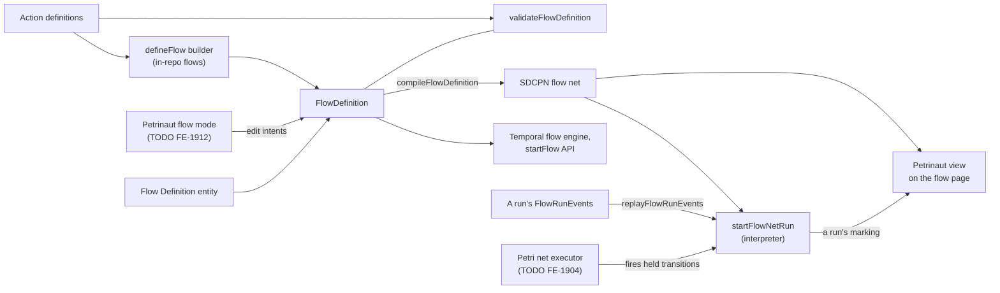
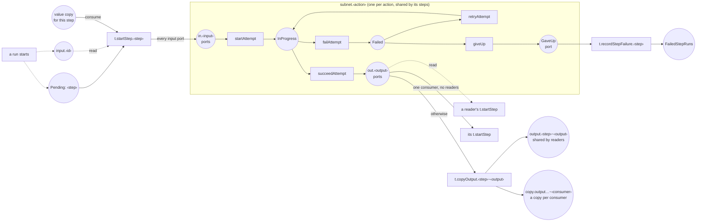
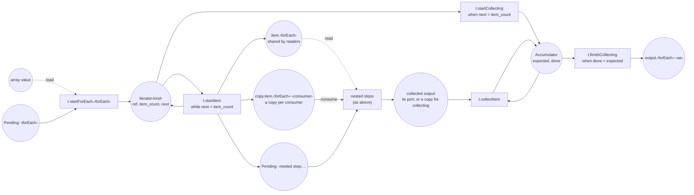

# @local/flow-petri-net

Compiles a `FlowDefinition` into the Petri net (SDCPN) that Petrinaut renders, and interprets a compiled net to work out a run's tokens: from a run's recorded events now, and for a net executor eventually.

## Where this fits

A flow has one definition, its `FlowDefinition`. Everything else is derived from it.

- **`FlowDefinition`** (`@local/hash-isomorphic-utils/flows/types`) is the source of truth for what a flow does: its inputs, steps, connections and outputs. It's plain JSON, validated by `validateFlowDefinition`. Every connection is checked by `canConnect`, the one compatibility rule, which the builder's types mirror at compile time. Definitions say nothing about how a flow is started: triggers are separate.
- **The current Temporal engine** runs definitions directly, until the net executor replaces it (TODO FE-1904).
- **The flow net** is compiled from a definition, deterministically and in one direction. Definitions stay the source: the net's design will keep changing, which only means recompiling.

## Entry points

- `@local/flow-petri-net/compile-flow-definition` exports `compileFlowDefinition(flowDefinition, { layout }): Promise<SDCPN>`. It's async because it lays the net out with Petrinaut's ELK layout. With `layout: false` it leaves every node at the origin, for a net that runs rather than one that's shown, such as in a Temporal workflow, where ELK can't run.
- `@local/flow-petri-net/flow-net-keys` exports the functions every key in a compiled net is made with (see **Ids** below), so that anything reading a net, such as an executor or a run's view, can work out an element's id.
- `@local/flow-petri-net/flow-net-metadata` exports the types of what a compiled net records in its metadata (see **Metadata** below): `TransitionRole`, each role's `TransitionMetadata`, `InputSource`, and the root's, instances' and subnets' metadata.
- `@local/flow-petri-net/interpret-flow-net` exports `startFlowNetRun(net, { flowInputNames, waitForStepStarts }): FlowNetRun`. It runs a compiled net by its transitions' roles, working out the tokens itself. Each transition is either internal or held:
  - an internal transition fires as soon as it's enabled: `startAttempt`, `copyOutput`, `startItem`, `startCollecting`, `collectItem`, `finishCollecting` and `recordStepFailure`;
  - a held transition (`heldRoles`) can be enabled and still wait, because what happens outside the net decides whether it fires, and the driver fires it: an attempt's `succeedAttempt`, `failAttempt`, `retryAttempt` and `giveUp` always; `startForEach` unless its array is a constant, as it needs the array's length; and `startStep` only with `waitForStepStarts`. A failure that's retried is two firings, `failAttempt` then `retryAttempt`.

  `held()` lists the held transitions that are enabled, each for a step run, and `fire(heldFiring)` fires one, with an item count or the outputs an attempt produced, then every internal transition that enables, and returns those firings. `isHeld(role, stepRun)` and `attemptInProgress(stepRun)` answer for one step run without listing every other one, so a replay of a large `forEach` doesn't redo the whole list on each event. `attemptInputs(firing)` gives the inputs a `startAttempt` firing started its action with, for an executor to call the action with. A place inside a step's instance is identified with the instance, since every instance of a subnet shares its places' ids. Read arcs from one place can read the same token, as when two inputs of a step read the same value.

- `@local/flow-petri-net/replay-flow-run-events` exports `replayFlowRunEvents(net, events)`, which fires the held transitions a run's `FlowRunEvent`s record. It returns the run's initial marking, each firing with the event that caused it, the marking and the held transitions enabled after the last event, and the events the net couldn't follow. It holds each action step's `startStep` until its `stepStarted` event: the executor only starts the steps that are ready once every step of the batch before has finished, so a step can have its inputs well before it starts.

Its implementation is in `src/compile-flow-definition/`:

- `compile-action-step.ts` and `compile-for-each-step.ts` add each kind of step to the root net.
- `generate-action-subnet.ts` makes the subnet an action's steps are instances of.
- `shared/` holds what those share: the step index (`flow-steps.ts`), the net being built (`net-builder.ts`), where each value is held (`value-places.ts`), colours, kernels, layout, and helpers for making places, transitions and arcs.

## What a compiled net looks like

Places are circles and transitions are boxes. Dashed arrows are read arcs, which don't consume the token. Places, transitions and instances are labelled by the keys their ids are made from (see **Ids** below).

A for-each step adds an iterator and an accumulator around its nested steps:

- **Runs.** The net has no transition that starts a run. The executor starts one by putting a token in each flow input's places, and a `Pending` token in each top-level step's place, which the root's `metadata.flowInputs` and `metadata.pendingAtStart` list. Steps inside a for-each step get theirs when each item starts.
- **Ids.** The compiler builds the net from readable keys, such as `p.input.prompt`, `t.startStep.<step>` and `i.<step>` for a step's instance, all made by the functions in `src/flow-net-keys.ts`. Step ids can be any string without `~`, so instances have keys of their own, and `~` is what separates a step id from an output name (`p.output.<step>~<output>`), and a value from the consumer of its copy. Copies have a namespace of their own (`p.copy.output.<step>~<output>~<consumer>`), as a flow input's name can contain `~`. Kernels address places by name, so a value's place is named by its key. Every id in the compiled net is the Petrinaut id of its key (`toPetrinautId`, a UUIDv5), which is what Petrinaut converts a non-UUID id to when it loads a net. So loading a compiled net changes nothing, and anything that needs an id works it out from the key. The endpoints in the root's metadata are converted too.
- **Steps.** Each action step is a component instance of its action's subnet, keyed `i.<step>`. Its `t.startStep.<step>` fires once per run (or per item), because it consumes the step's `Pending` token. It reads or consumes each connected value according to the connection's `access`, which defaults to read, matching today's semantics. It feeds every input port of the action:
  - a connected value;
  - a constant, recorded in the instance's `metadata.constants`;
  - or, for an optional input with nothing connected and no default, a token marked absent (`present: false`).
- **Ports.** Actions have a port per input and per output. Keys inside a subnet are prefixed with the action id (`p.<action>.in.<input>`, `t.<action>.startAttempt`), because Petrinaut keys compiled kernels by unscoped id.
- **Outputs.** A transition is only added where one token has to become several. A step's output stays in its instance's output port:
  - steps that only read it read the port, with read arcs;
  - a single step that consumes it, with no readers, takes it from the port;
  - otherwise a `t.copyOutput.<step>~<output>` transition puts it in a place shared by the readers (and by a flow output), and in a copy for each step that consumes it, so consumers never race for a token.

  So a step's output has no fixed place: it's the port of the step's instance or a copy place, and anything that needs to find a value looks it up. An action with no outputs leaves its `done` token in its port.

- **Flow inputs and collected outputs.** The executor, when a run starts, and a for-each step's `t.finishCollecting` put a value straight into a place shared by its readers and a copy for each step that consumes it.
- **For-each steps.** A for-each step iterates over its array:
  - `t.startForEach.<id>` turns the array into an iterator token, `{ref, item_count, next}`.
  - `t.startItem.<id>` starts one item per firing: it puts the item where each nested step takes it from, as for any other value (a place shared by the steps that read it, and a copy for each step that consumes it), and a `Pending` token for each nested step.
  - `t.startCollecting.<id>` hands over to an accumulator, `{expected, done}`.
  - `t.collectItem.<id>` consumes each item's collected output and counts it.
  - `t.finishCollecting.<id>` emits the collected output once `done` equals `expected`.

- **Tokens.** Tokens carry references to payloads, not the payloads themselves. Every colour has `run_id`, and `item_path`: empty outside any `for-each`, the item's index inside one (`"2"`), and the indices of the enclosing items, outermost first, inside nested ones (`"2.0"`).
- **Colours.** Each payload kind, and an array of it, is a colour with `ref` and `present`, and `item_count` for an array. (Not `length`, which Petrinaut's kernel language reserves.) Each kind has its own display colour.
  - An input or output whose kind another input decides (`kindFrom`) is typed by the kind a step connects, so an action gets a subnet per combination of kinds its steps use.
  - Any other input accepting several kinds has a `oneOf` colour, such as `Text | WebPage`, with a `kind` element saying which kind the token carries.
  - A `for-each` step's iterator is typed by the kind of array it walks (`Iterator<Text>`).
- **Metadata.** The root carries `metadata.flowInputs`: for each flow input, the places a run puts it in; `metadata.pendingAtStart`: the `Pending` places of the top-level steps; and `metadata.flowOutputs`: for each flow output, the arc endpoint it's found at, a place of the root net or an instance's output port. Every transition added for a step names it in `metadata.stepId`, so a run's view can map steps to the net and back; a for-each step's `t.collectItem` also carries its `collect`. A step's `t.startStep` carries `inputSources`: for each of the action's inputs, the arc endpoint its value comes from with the connection's `access`, `wrap` and `whenMissing`, or that it's a constant, takes its default, or is absent. The arcs alone don't say which value feeds which input. Each transition carries `metadata.role` (see `TransitionRole` in `src/flow-net-metadata.ts`), which tells the executor how to treat it:
  - `succeedAttempt` and `failAttempt` fire when an action's activity completes, and `retryAttempt` or `giveUp` as the retry policy decides; `startForEach` fires once its array's length is known, unless it's a constant (see `interpret-flow-net` above);
  - every other transition fires as soon as it's enabled, including `recordStepFailure`, which moves a step that gave up into `FailedStepRuns` and so fails the run.

## Limitations

- **No guards.** Kernels only carry `run_id` and `item_path` forward and give every other attribute a default (`compile-flow-definition/shared/kernels.ts`). There are no guards yet: no correlation across inputs, and no iterator or accumulator conditions. So a compiled net builds in Petrinaut but doesn't simulate meaningfully. `interpret-flow-net` interprets roles instead.
- **A `for-each` step's shared item tokens stay after their item finishes.** The steps inside the `for-each` that read the item read it from one place, and nothing consumes it there. Consuming it needs a transition that knows every step of that item has finished, which needs the item correlation that FE-1914 adds. A step that consumes the item takes its own copy.
- **Skip-if-missing** (`whenMissing: "skip"`) has no transition yet. The interpreter holds a step while a value it skips on is missing; skipping it is left to the executor (TODO FE-1904).
